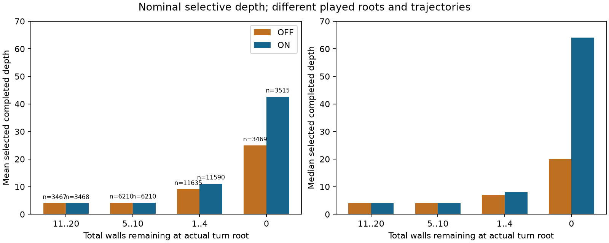
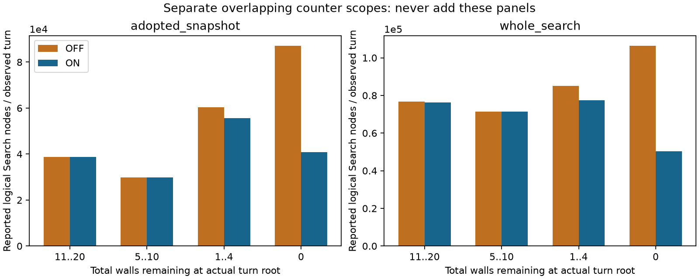
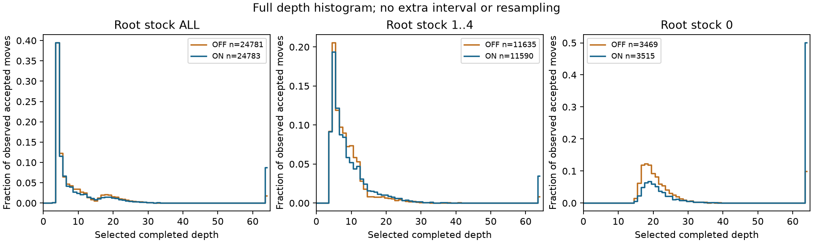

# 追補：cutoff ON/OFFで深さ・探索量はどう変わったか

**ONで名目の読みは深くなったが、差は残壁の少ないrootと飽和に近い値へ集中した。残壁5以上のrootは深さがほぼ同じで、同じ履歴の分岐前rootでも、ONが深くなって着手を変えない例が多かった。** この観測は旧速度結果と今回の小さい得点差が両立する説明候補を絞る。勝率差の原因や「差がない」ことを確定するものではない。

原report/result/RNG receiptは凍結したまま。原1024局はLEFT ON **514勝1分509敗、得点率.50244140625、唯一の95%区間[.4853515625,.51953125]、UNRESOLVED**。Stage9の既定分岐はpath_tail維持。新しいCI・RNG・対局・forward・fit・solverはない。

## 全turnの深さとwork

1024局/512 true canonical familiesから**49,564 turn**を受け入れた。OFF 24,781、ON 24,783。各methodとも全1024局/512familyに観測がある。全turnがaccepted、depth・二つのnodes/evaluation counter・stopの欠測0、stock/色/履歴/着手対応の検出不整合0。以下は実際に異なる着手とrootを通ったturn集合で、同work throughputや全turnの同局面因果比較ではない。

| 量                       |      OFF |       ON |
| ------------------------ | -------: | -------: |
| 観測turn / accepted move |   24,781 |   24,783 |
| completed_depth 平均     |   9.3831 |  12.8637 |
| completed_depth 中央値   |        5 |        5 |
| depth64到達              |      443 |    2,167 |
| caller秒/turn（nested）  | 0.098244 | 0.091447 |

| scope            | method |     nodes合計 | nodes/turn 平均・中央値 | static_evaluations合計 |  同/turn 平均・中央値 |
| ---------------- | ------ | ------------: | ----------------------: | ---------------------: | --------------------: |
| adopted_snapshot | OFF    | 1,324,382,358 |   53,443.46 / 45,432.00 |            664,358,348 | 26,809.18 / 25,897.00 |
| adopted_snapshot | ON     | 1,106,618,679 |   44,652.33 / 40,835.00 |            583,034,819 | 23,525.59 / 23,205.00 |
| whole_search     | OFF    | 2,069,672,398 |   83,518.52 / 79,754.00 |          1,187,170,399 | 47,906.48 / 47,896.00 |
| whole_search     | ON     | 1,780,744,451 |   71,853.47 / 75,864.00 |          1,075,367,055 | 43,391.32 / 44,689.00 |

`completed_iteration_counters`は採用したcompleted iterationの**累積snapshot**、`counters.whole_search`は最終returnまでの**未採用iteration/未完了tailも含む累積counter**。同じworkが重複するため足さない。snapshotからwholeまでの差分も別測定kernelではない。`static_evaluations`は報告された論理counterで、FT/head等の物理呼出し数を確定しない。`physical_nn_calls`は全turnでnull、UNKNOWNである。

両methodのwhole_search.nodes合計は数値上3,850,416,849となり原課金値と一致するが、課金側はopaque reservationsを含む別ledgerである。数値の一致からopaque内訳0や物理訪問数を推定せず、原課金値を観測node counterの代用品にしない。

per-turn平均とper-game/family集計を分け、全1024局×methodの[per-game-summary.csv](../../../../.worktree/assets/perf/cedar-path-tail-strength-analysis-v1/results-v1/per-turn-addendum-v1/per-game-summary.csv)、全512family×methodの[per-family-summary.csv](../../../../.worktree/assets/perf/cedar-path-tail-strength-analysis-v1/results-v1/per-turn-addendum-v1/per-family-summary.csv)、actor色/LEFT色/lane/operation/source tuple/source partition/opening長/分岐後を含む[turn-summary.csv](turn-summary.csv)を保存した。全depth 0..64の明示的な頻度・n・欠測は[depth-full-histograms.csv](depth-full-histograms.csv)。全体中央値だけで序盤rootと終盤tailを混ぜて説明しない。

## 残壁別：追加の名目depthはどこにあるか

stockは**そのturn開始時点の両者残壁合計**。保存済みnative rootのwalls_left/turn/total_plyと、opening込みOutcome.moves、observation.ply/side/actionを対応させた。prefixを二重に減算せず、既存Action codecの0..80=駒、81..144/145..208=壁という分類で、当該actorの残壁だけ減算した。canonical IDやslotの偶奇でactorを決めず、実side/engine_index/LEFT色を使用した。幾何・合法性・BFSの再生はない。stock UNKNOWNは0であった。

| root残壁 | turn数 OFF / ON | 平均depth OFF / ON | 中央値 OFF / ON | depth64 OFF / ON | whole nodes/turn OFF / ON | caller ms/turn OFF / ON |
| -------- | --------------: | -----------------: | --------------: | ---------------: | ------------------------: | ----------------------: |
| 11..20   |   3,467 / 3,468 |    4.0182 / 4.0121 |           4 / 4 |            0 / 0 |     76,851.85 / 76,199.92 |         99.648 / 99.706 |
| 5..10    |   6,210 / 6,210 |    4.2147 / 4.2126 |           4 / 4 |            2 / 1 |     71,459.25 / 71,320.76 |         99.699 / 99.775 |
| 1..4     | 11,635 / 11,590 |   9.0980 / 11.1171 |           7 / 8 |         99 / 405 |     85,104.11 / 77,381.74 |         99.154 / 96.979 |
| 0        |   3,469 / 3,515 |  24.9533 / 42.6401 |         20 / 64 |      342 / 1,761 |    106,451.07 / 50,277.92 |         91.182 / 50.348 |

残壁0では中央値20→64、caller平均91.18→50.35msで、ONのdepth64は1,761/3,515 turn。残壁1..4も平均9.10→11.12へ変化した。一方、残壁5..10と11..20の中央値はいずれも4で、平均も4.21、4.02付近のまま。rootに壁が残っていても探索内部でstock0に達し得るため、rootstock帯をcutoff発動の分母や発動場所と同一視しない。

## 値が±1に近いturnとの関係

| root残壁 | method | abs(value_stm)>=.99 turn | 同depth64 | abs(value_stm)<.9 turn / 平均depth |
| -------- | ------ | -----------------------: | --------: | ---------------------------------: |
| 11..20   | OFF    |                        5 |         0 |                     3,447 / 4.0139 |
| 11..20   | ON     |                        5 |         0 |                     3,445 / 4.0110 |
| 5..10    | OFF    |                      186 |         2 |                     5,515 / 4.1588 |
| 5..10    | ON     |                      200 |         1 |                     5,505 / 4.1586 |
| 1..4     | OFF    |                    4,364 |        99 |                     5,585 / 6.3751 |
| 1..4     | ON     |                    4,852 |       405 |                     5,310 / 6.2981 |
| 0        | OFF    |                    3,304 |       342 |                       55 / 17.1818 |
| 0        | ON     |                    3,455 |     1,761 |                       22 / 16.8182 |

depth64に達したOFF443/ON2167 turnはすべて保存値のabs(value_stm)>=.99帯だった。これは値と名目depthの**記述的な対応**で、証明leafの発動を区別するcounterがないため、飽和したNNUE値か証明結果かをこの表だけで分類できない。名目depthはLMR/証明leaf shortcutを含む選択的なdepthであり、全幅の64手読みや真のWDLを意味しない。「既に勝敗が決まっていた」とは結論しない。

## 同じ開始履歴の二色局は、どこで着手が変わったか

各canonical familyの二局でfull opening、native root全体、counted history、lineage、実LEFT色を一致させた。双方の着手列が一致するrootだけを、**最初の着手分岐rootを含めて**対応させる。各rootの実engine_index/sideでON/OFFを向け直し、分岐後は再び同じboardに見えてもcounterfactualとしてpairしない。

| 同root残壁 | matched root | ON深い / 同深さ / OFF深い | 同着手 | ON深いが同着手 | 最初の着手分岐 |
| ---------- | -----------: | ------------------------: | -----: | -------------: | -------------: |
| ALL        |       12,113 |        867 / 10,791 / 455 | 11,641 |            702 |            472 |
| 11..20     |        3,015 |           26 / 2,957 / 32 |  2,952 |             18 |             63 |
| 5..10      |        4,472 |           73 / 4,333 / 66 |  4,348 |             55 |            124 |
| 1..4       |        4,566 |         730 / 3,480 / 356 |  4,290 |            595 |            276 |
| 0          |           60 |               38 / 21 / 1 |     51 |             34 |              9 |

全12,113 matched rootsのうち10,791は同じdepth、ONが深い867件のうち702件は同じ着手だった。472familyで最初の着手分岐を観測し、分岐後のpair数は0。残壁0のmatched rootは60件/9familyだけで、全軌跡のstock0 6,984 turnを代表しない。停止位置が最初の分岐で選択されること、colour gamesの時点/私有TT/過去Search workが異なること、3laneの周波数・cache帯域変動を保持する。702/867を一般的な「約81%は無効」や因果確率にはしない。

全common-root行は[common-prefix-roots.csv](../../../../.worktree/assets/perf/cedar-path-tail-strength-analysis-v1/results-v1/per-turn-addendum-v1/common-prefix-roots.csv)、familyごとの最初の分岐・対応数は[family-branch-summary.csv](family-branch-summary.csv)。depthだけで候補手rankや見落とし率は分からず、rankはUNKNOWN。

二色family結果は**LEFTがseat0の局→seat1の局**の順で WW41、WL213、LW218、LL39、DW1、その他draw組合せ0。collapsedでは両勝41/一勝一敗431/両敗39/一分一勝1。[family-outcome-patterns.csv](family-outcome-patterns.csv)に全9組合せを保存した。独立trialを1024や多数のturnへ増やさず、新しい局所CIは作らない。

## stop、clock、fallback

| 観測項目                        | OFF (n=24,781) | ON (n=24,783) |
| ------------------------------- | -------------: | ------------: |
| stop=depth_cap                  |            443 |          2167 |
| stop=internal_time_limit        |          24315 |         22589 |
| stop=cancelled                  |             23 |            27 |
| stop=node_cap                   |              0 |             0 |
| legal fallback                  |              0 |             0 |
| 採用snapshotの受領が期限前      |          24781 |         24783 |
| terminal drain returnが期限以後 |           5410 |          5749 |
| legal確認後commitが期限以後     |           5977 |          6358 |

stop/missingは全49,564件で観測され、node_capとlegal fallbackは観測分母上0。stop=cancelledはOFF23/ON27で、一般のenumをそのまま残した。`reserve_stop_is_not_user_cancel=true`は設計上の区別で、各cancelled事象の細かな原因やsafe-race activationを示す計数ではない。

採用snapshotのauthority receiptはすべて設定deadline前だった。terminal drain/stack cleanupのreturnや、その後の合法確認commitは期限後となる件数がある。これは**snapshot受領とterminal収集/commitを分けた既存のclock契約**であり、hard realtime完了保証ではない。caller/thinkingはnested spanで、Search・setup・returnへ重ねて加算しない。ONがdepth_capで早く返った時間を次turnの100msへ繰り越す仕組みもない。clockの違いを一般的な棋力原因として断定しない。

## 旧32prefixの速度結果との違い

方針相談が既存call-metrics.csvから読んだ保存事実として、旧32入力は初期残壁0が2、1が22、2が8、3以上0（2 correlated series/26 board keys）だった。旧CSVや旧RAWを本追補で読み直していない。旧Cedarのpath_tail/OFF Search比約.764は、この**初期残壁0..2に集中した小集合**の値で、全ゲームを一様に約24%速くする測定ではない。

今回の512開始familyは初期残壁0..2が0、4が85、5..10が170、11..20が257。stock0はゲーム中のtailである。旧集合と対象root・軌跡・source/image・clock scopeが異なるので、旧速度比を今回のturn比率に掛けたり勝率効果へ変換しない。

観測から言えるのは、(a)ONの追加の**名目**depthは存在する、(b)差が低残壁/abs(value)>=.99と結び付く、(c)高残壁側の通常rootや分岐前rootの多くは同depth/同着手、(d)この有限trialで強さ差の方向は未確定、までである。追加depthが重要な選択を変えにくかった可能性、両側の同Cedar/LMR/TT/clockによる共有制約、別軌跡/並列変動などが競合する。どれが得点差を小さくしたかは分離できない。同等性、教師真値、learning-onlyの因果や一般棋力を採用しない。

## 観測できないものと、必要なら将来確認する最小境界

arenaのalpha_countersにはnodes/evaluations等があるが、measurement-onlyの `safe_race_stock0_opportunities`、`proven_leaves`、region clocksは投影されていない。`counters.cutoffs`は一般alpha-beta cutoffである。発動数・発動率・時間がUNKNOWNのままなので、「あまり発動しない」とは言えない。候補手rankと真のWDL、物理NNUE、連続peak/full feesもUNKNOWN。

今後その因果を問うなら、既に測定されるsafe-race機会/証明leaf/region clockを、adopted snapshotとwholeの区別を保って少数のarena fieldへ投影するのが最小候補となる。既存値がなければ新計測の費用を別途判断し、fullhistory scan・旧predicate再演・persistent mapを足さない。候補rankも既存root順序情報の有無から確認する。本追補からその実装、observer、新jobや追加対局は発行しない。

## custody・費用・保存境界

原96局のFAILED/native exit1/NULL/false/masksは別acceptance d1c81a3eのまま保持し、旧image75f/BUILD637/source6d2/caller524f、修復reader4fと、新928局image2be3/BUILD9ea/source9a/caller4fを混ぜて同一binaryの主張にしない。今回ロードした保存readerは実current LC **d0205968/284621** で、reader3関数のAST同一と読取handle closeを短いimport期間だけ束縛した。原データの実行sourceをd020に貼り替えていない。Main/Git/Cargo/task10全体を保持するleaseはない。

最初の追補readerは共有40MiB capで -15/3.823041306983214sのFAILEDとなり、op0..30の31成功投影/992局を保存、op31はENTEREDのみでdecode完了UNKNOWNだった。同じ352MiBのままpost-consumer allocation c8691b05（各lane96MiB+shared64MiB）へ解決後、**許可されたop31一回だけ**を補完した。成功31archiveを再decodeせず、op31の部分decode重複の可能性も否定しない。original ENTERED/COMPLETEの63小receipt全byteはlossless packed custodyへ保存した。二つの成功filename-lookup stdoutだけはcanonical recordsからbyteexact再構成を確認した重複を整理した。元RAW/archive/models/FAILEDは削除していない。

集計は保存必要列から一度行い、Root提供の部分992/496familyの算術とも一致した。これは独立な追加証拠ではない。元のone PCG64のsource/input/output/receipt・report・判定を変更しない。新GPU/head/Search/game/fit/RNG/旧テストは0。原3850416849課金、旧FAILED206.627018s、新3lane/control/nested clockの元記録も変更せず、新しい解析wallを対局clockへ足さない。

正本は[descriptive-result.json](descriptive-result.json)、集計sourceは[summarize_saved_turns.py](../../../../.worktree/assets/perf/cedar-path-tail-strength-analysis-v1/results-v1/per-turn-addendum-v1/summarize_saved_turns.py)、32入力とtuple対応は[archive-pass-bindings.json](archive-pass-bindings.json)、中断後の補完と投影FileRefsは[recovered-projection-completion-v1.json](recovered-projection-completion-v1.json)。最終completionは実STOPと新affected pointを束縛する。新support・旧quota貸与/返金・原結果の再採否は0。
