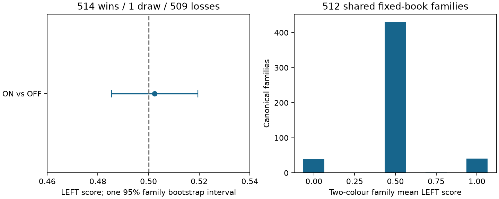
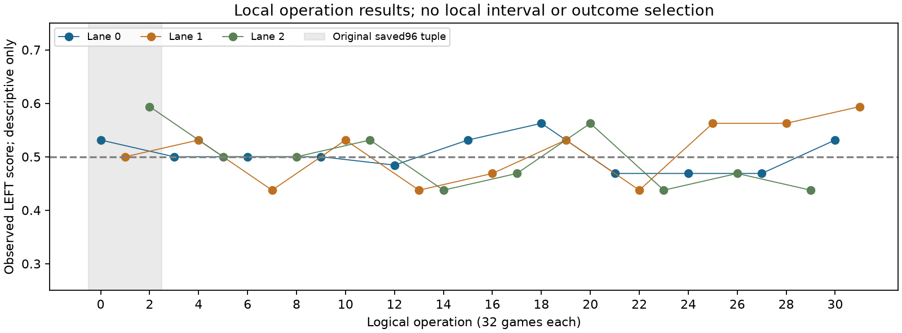

# Cedar path_tail ON/OFF：原1024局の保存解析

LEFTのpath_tail ONは **514勝1分509敗、得点率0.50244140625**。512 canonical familyを単位とする唯一の95% percentile区間は **[0.4853515625, 0.51953125]** で、固定book・clock・並列cohortでの主判定は **未確定（UNRESOLVED）**。同等性や効果不存在を示す結果ではない。事前規則によるStage9のcutoffは **path_tail維持**。Stage9の対局は本解析から発行しない。

LEFTは同じCedarの `safe_race=true/method=path_tail`、RIGHTは `false/method=manhattan`。両者は同一Cedar BEST58305（typed `eb0fbc9357252e916b1c6314bee6f6c76d975828c15cc439cceb9766309fb5b9`）、Control/PVS、LMR ON/depth_rank、TT要求1M、100ms/5ms reserve、Search safety1M、depth64、200ply、approx OFF。safe-race以外の条件を固定したengine比較である。

## 分母と推定

原32 logical operations、1024局、512組の両色がすべて完了し、UNKNOWNは0。goal1023、draw1。疎なglobal family ID・全prefix・root key・counted history・lineage・実LEFT色・scheduleを保存metadataで照合した。native表示名やordinal偶奇でfamily/色を推測していない。再利用した固定512開始集合であり、新しいheld-out集合ではない。

family平均は0点39組、0.5点431組、0.75点1組、1点41組。予定下限/上限とも0.50244140625。単一主比較としてfamily 512個を復元抽出し、PCG64/seed32482026101802、10000 resamples、linear95%を一度実行した。native32 batchのxorshift/2000区間は診断としてCSVに保存し、平均・混合・最終採否への転用はしない。旧7や旧学習のCIも混ぜない。

実draw tableは10000×512/int64/little、SHA `06c8ca73ddad3853955342e4c9cd6db9b058f67e8bbbeda90cc532a00f0e54e5`、choice呼出し1回。40MiBの表本体は保存せず実生成bufferをその場でhashした。実Python3.14.7/NumPy2.5.3、source/input/settings/output/receiptとPID/start/boot・返却を束縛した。実receiptのentered→completedは `2026-10-18T09:08:44.308532+00:00` → `2026-10-18T09:08:44.549358+00:00`。これは保存解析のclockであり対局clockではない。

## 局所結果（記述のみ）

|区分|n局|LEFT W/D/L|LEFT得点率|
|---|---:|---:|---:|
|LEFT_seat=0|512|254/1/257|0.49707031|
|LEFT_seat=1|512|260/0/252|0.50781250|
|lane=0|352|177/1/174|0.50426136|
|lane=1|352|179/0/173|0.50852273|
|lane=2|320|158/0/162|0.49375000|
|source_tuple=new928_image2be3_BUILD9ea_source9a_caller4f|928|462/1/465|0.49838362|
|source_tuple=saved96_image75f_BUILD637_source6d2_caller524f_reader4f|96|52/0/44|0.54166667|
|prefix_length=12|252|123/0/129|0.48809524|
|prefix_length=16|258|131/1/126|0.50968992|
|prefix_length=4|254|130/0/124|0.51181102|
|prefix_length=8|260|130/0/130|0.50000000|
|source_partition=train|802|399/1/402|0.49812968|
|source_partition=validation|222|115/0/107|0.51801802|

32 operationsの完全な局所結果は[operation-summary.csv](operation-summary.csv)、全局は[games.csv](games.csv)、全familyは[families.csv](families.csv)。局所区間・局所選択・有利なsubset採否は追加していない。

## 実行tupleと失敗の扱い

最初の96局（operation0..2）は元cohortがFAILED/native exit1/NULL capture/false cleanup等を保持したまま、別のrepaired-data acceptance `d1c81a3e` で保存データを受け入れた。物理retry0..2は0。実測tupleは旧image75f/BUILD637/source6d2/caller524f、修復reader4f。残り928局（operation3..31）はimage2be3/BUILD9ea/source9a/caller4fで正常PASS。両tupleを同一binaryの資格や速度同等性とは扱わない。元FAILED、persisted masks、NULL-vs-disk、個別manifest/reader STOPの意味を遡及変更しない。

解析側のgeneric storage observerによる未作成宣言root拒否、旧operationのcharged_nodes receiver誤り、Python3.11/3.14 AST表現差によるbootstrap事前拒否も保存した。最後の拒否は数学関数到達前・choice0・output/receipt未作成で、実interpreter上の同一関数ASTの設定参照だけを修正した後、唯一の実drawが成功した。失敗をPASSに書き換えず、旧suite・model・RAW・CIの成功再演はない。

## 費用とclock境界

旧96 charged358239974＋新928 charged3492176875＝**3850416849**。opaque reservationsを含む課金nodeであり、visited Search nodesや物理NNUE head数ではない。各operation500M、whole16Gの非貸与上限を保持する。旧FAILED残高387171225/374707804/379880997、新operation未使用残高も貸与・返金しない。

旧FAILED cohortのouter206.627018sは歴史的な一回の費用。新3lane outerは1809.323352345964 / 1825.6912492440315 / 1663.2618941760156sで並行しており、合算しない。新submission created08:13:14.950382Z→last outer finished08:43:57.842145Zの**1842.891763s**はadmissionを含むcontrol windowで、nativeだけの時間ではない。native/operation/archive等のnested spanを追加加算しない。native exact UTC、全fees、連続peak、physical NNUE callsはUNKNOWN。report.nn_calls=0はinference-pump counterで、NNUE推論0を意味しない。

## 解釈の範囲

本結果は再利用512family・同Cedar・固定clock・3lane並列・上記mixed tuplesに限る。旧32prefixの純速度観測から勝率への因果量を計算しない。名目depth・work・clock fallbackのturn値は今回のcompact projectionに無いため、この原reportではUNKNOWN。人間が追加依頼したturn説明は別addendumとして保存し、本report/CI/判定を上書きしない。

区間は.5を含むため、強さ差の方向を確定できない。教師一般の優劣、学習のみの因果、同等性、general speed、model/default昇格を結論にしない。prior public/game history・prefix内部の過去露出はUNKNOWN。追加game、solver、head、fit、poolや観測器は発行していない。

正本対応は[result.json](result.json)、入力の135小metadata参照は[analysis-read-refs.json](analysis-read-refs.json)、唯一の数学実行は[bootstrap-receipt.json](bootstrap-receipt.json)と[bootstrap-returned-lifetime.json](bootstrap-returned-lifetime.json)。原判定は凍結し、owner acceptanceまでleafをin_progressとする。
