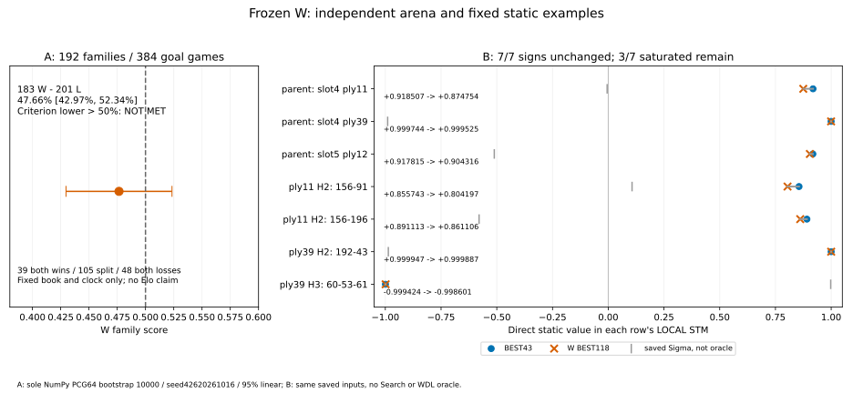
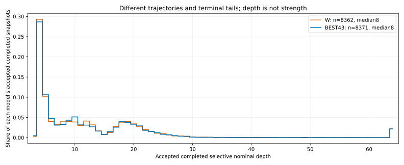

原426の有限比較は、Wの改善支持基準を満たさなかった。独立した192開始family・384局は全GOAL、W183勝201敗、score47.65625%、事前固定のfamily bootstrap95%区間42.96875–52.34375%だった。下限>50%は未達であり、一般優越・非劣性・Elo・モデル/既定昇格を支持しない。区間は50%を含むため、劣位・等価・改善不可能を証明した結果でもない。Bの同じ7局面では新Wのlogit絶対値は小さくなったが、全7符号と強い飽和3件は残った。

| 主対照W対凍結BEST43 | 実績 |
| --- | ---: |
| 予定 / started / returned / GOAL | 384 / 384 / 384 / 384 |
| 完全family / 不完全family / UNKNOWN | 192 / 0 / 0 |
| W-D-L / score | 183-0-201 / 47.65625% |
| family両勝ち / 片勝ち / 両負け | 39 / 105 / 48 |
| Wが色0 / 色1の勝ち | 92/192 / 91/192 |
| sole192-family95%区間 | 42.96875–52.34375% |
| 事前の下限>50%基準 | NOT_MET |

入力はprefix seed42620261017、4/8/12/16ply round-robin、owner seed42620261018、arena RNG42620261019。既知5冊528prefixを除外し、ALL候補と除外のLR/extension/endpoint推移閉包を既存native ownerで扱った。保存成功したrules-only候補は2048、canonical family2048、欠測0で、予定順の先頭192を結果前に固定した。初回rules-only記録FAILEDの未保存workはUNKNOWNとして原0.179825689sを保持し、明示した同設定recovery0.223046074sとは分ける。これはarenaやモデル成功分の再演ではない。

選択された192件は実native request ID0..191とselection ordinalが一致したが、集計はその偶然や表示名に依存しない。bookの完全prefix/root key/history counts、carrier canonical family、schedule slot、各操作のnative lineage、原CSVを一対一で結んだ。192canonical familyは異なり、familyごと二色を保持する。通常native入力受入れを再用し、Pythonで分類・ルール・履歴を再演していない。公開全域の欠けたgame provenanceや全軌跡の統計的独立まで確認したという意味ではない。

対照は同じ凍結W BEST118とBEST43だけ。W typed8a8eb7fb、BEST43 typed96a5f41f、同image35e47e65/Build9bf66048、Control/PVS/TT1048576、LMR ON-depth_rank、scalar/SIMD false、100ms authority receipt/5ms reserve、1M nodes/手、名目depth64、prefix込み200ply、近似/safe leafOFFを維持した。12×32slotの250Mずつ、総3G。actual charged1,640,581,337、未使用1,359,418,663は貸与・補充しなかった。モデルpayload再読/再hash/再fit/再選抜、旧対局・旧CIの再演は0。

主指標は各二色family scoreの非加重平均である。今回drawがないためfamily scoreは0/.5/1、39×1＋105×.5＋48×0を192で割ると183/384になる。予定欠測boundsはこの全完成例では同じ47.65625%へ縮むが、95%区間とは別である。12個のnative16-family区間はA-core-summary.jsonへ原値のまま保持し、平均・連結しなかった。旧423の64family・56.25%・旧O1付き区間も合算していない。異なるbook/時点の旧結果との違いを、重みの劣化や一要因の因果効果にしていない。

今回の統計は10000 resamples、PCG64、seed42620261016、95% percentile/linearを一度だけ実行した。実行本体family_bootstrap426_bounded.pyは元87ec6094の統計関数ASTを完全保持し、入力の最初と再確認を131073Bまでの読取、出力を排他的x modeへ限定しただけである。元source、修復記録、実行前FileRef、実input、actual Python3.14.7/NumPy2.5.3、output、PID/start/boot/directwait/reap/STOPをstatistical-execution-binding.jsonへ結んだ。実行したchoice/mean/quantile本体を、一般guardや事後の再構築で代用していない。元423のO1と原値は変更していない。

| 実行証拠 | SHA先頭 / bytes |
| --- | --- |
| 実統計本体、関数ASTは元87ecと同一 | 0cbb5093 / 4275 |
| 192family実入力 | fd16d1d2 / 22170 |
| RNG / quantile | PCG64 / linear |
| bootstrap実STOP | 23:08:39.327750Z |
| 今回12RAW一回streamの実STOP | 23:11:49.571963Z |

区間は固定book・交換可能なfamilyを仮定した有限な記述であり、全Quoridor開始条件、同じ系列中のmove、色別384局を独立標本にしたものではない。事前基準が未達だったことを受けて追加局・cap/depth/seed sweepで埋めていない。

今回の12原archiveだけを一回ずつstreamし、gzip CRC/EOF・rawSHA/bytes・圧縮FileRef前後を照合した。384records、16,733accepted、全て有効なcompleted snapshot、fallback0、game failure/forfeit0、engine error0、authority illegal0、snapshot validation failure0、receipt late0だった。全観測でmatching terminal collectedを確認した。source/RAWの完全copyは作らず、per-game照合表、集約counter/深さ分布と最初の2rootだけを残した。

| 観測分母 | W | BEST43 |
| --- | ---: | ---: |
| accepted / completed snapshot | 8362 / 8362 | 8371 / 8371 |
| accepted depth中央値 / 平均 | 8 / 11.6863 | 8 / 11.5656 |
| depth<=5 / depth>=20 / depth64 | 3335 / 1388 / 183 | 3338 / 1364 / 179 |
| internal_time_limit / cancelled / depth_cap | 8159 / 20 / 183 | 8164 / 28 / 179 |
| receipt deadline後 | 0 / 8362 | 0 / 8371 |
| terminal returnがdeadline後 | 4247 / 8362 | 2025 / 8371 |
| state commitがdeadline後 | 4740 / 8362 | 2261 / 8371 |

cancelled48件はreserve_stop_is_not_user_cancel=true、completed snapshotを正規に返したmoveのstopであり、48UNKNOWNや人間のUSERPAUSEではない。receipt authorityは全件期限前であり、後のterminal return/commitをreceipt遅延にしない。caller中央値はW100.065ms/BEST43 99.563ms、thinking中央値68.238/68.567msだった。これらは互いに内包する時計であり、setup/Search/receipt/drain/dropやouterと足さない。差をNNUE部位費・思考の速さ・勝因に帰していない。

色別depth中央値はWが色0:8（n4167）、色1:9（n4195）、BEST43は色0:8（n4296）、色1:8（n4075）。全histogramは保存resultに保持した。LMR下の名目選択的深さであり、異軌跡・異手数と深いterminal側の尾部を含む。平均やdepth64件数をfullwidth・棋力・勝因の指標にはしていない。

| terminal whole work、別の内包view | W | BEST43 |
| --- | ---: | ---: |
| nodes | 817210511 | 823370826 |
| static_evaluations | 414878363 | 418520519 |
| PVS re-searches | 198397 | 193885 |
| TT probes | 359069446 | 361833542 |
| TT exact hits、raw counter | 428988 | 427200 |
| selected snapshot nodes、上のsubset | 580251127 | 586892463 |
| TT retained bytes、gauge | 83886128 | 83886128 |

ここではwhole nodesの和がcharged1,640,581,337と一致した。chargedが常にphysical forward数やvisit数と等しいという一般化はしない。selected snapshot仕事をwholeへ加算せず、raw exact hitを全てusable-depth cutoffへ読み替えない。TT bodyはRSSではなく、physical FT/head・continuous family RSS・孤立部位時計はUNKNOWN。値や軌跡が異なるため、同仕事speedupの比較でもない。未集計の長いnamespace文字列や追加scalarは原RAWに保持し、再decodeや偽の全件値で補っていない。

prefix長ごとのW-D-Lは、4ply:43-0-53、8ply:42-0-54、12ply:45-0-51、16ply:53-0-43（各48family/96局）。これは探索的な条件内訳で、16plyの有利な点推定だけを採用根拠にしない。開始stock合計は4..17で、16が43family、17が5family。18..20の開始は0だった。Aは最高在庫域の修正を直接検証しておらず、Bもstock最大16なので、その改善はUNKNOWNである。

最初のglobal family0を、最初の二色という固定データ順で例示する。完全prefixは[177,158,99,193]、ply4/STM0。原archive batch-000の行1/2、原行SHAと実続行はfirst-family-observations.jsonにある。

| 実snapshot | 着手 | root STM値 | 完成深さ | PV |
| --- | ---: | ---: | ---: | --- |
| W、game0 | 13 | +.49799535 | 4 | 13,205,146 |
| BEST43、game1 | 146 | +.54173744 | 4 | 146,206 |

同じ完全開始履歴だが別game/時計/TT/ordering/scratchであり、重み演算単独の介入比較ではない。実続行はそれぞれWの勝ちで、このfamilyはW両勝ちだった。これを一手のoracleや全体の代表的な勝因にはしない。

Bは同じ保存3親＋4endpointの新Wだけ7 canonical headsがCOMPLETE。constructor started/returned1・constructor heads0、full context7・head started/returned7、inclusive7<=28。oldNNUE/Sigma/D/delta/Search/MCTS/game/fitは0で、前回の422値を再用した。全7で完全prefix/実STM/在庫/壁/fullhistory・特徴ID/標準化distance bitsを保存422と一致させた。以下はlocal STMの直接static値であり、searched root値ではない。

| 固定状態 | stock合計 / STM | 旧NNUE post | W post | 旧pre→W pre | 保存D / Sigma |
| --- | --- | ---: | ---: | --- | --- |
| slot4 ply11、親 | 14 / 1 | +.918507 | +.874754 | 1.579391→1.352977 | -.099668 / -.005028 |
| slot4 ply39、親 | 2 / 1 | +.999744 | +.999525 | 4.482471→4.172984 | -.833655 / -.989549 |
| slot5 ply12、親 | 16 / 0 | +.917815 | +.904316 | 1.574982→1.495415 | -.099668 / -.511228 |
| ply11/H2/156-91 | 12 / 1 | +.855743 | +.804197 | 1.277223→1.110381 | -.291313 / +.106743 |
| ply11/H2/156-196 | 12 / 1 | +.891113 | +.861106 | 1.427306→1.297607 | -.462117 / -.579440 |
| ply39/H2/192-43 | 1 / 1 | +.999947 | +.999887 | 5.273468→4.889247 | -.800499 / -.986520 |
| ply39/H3/60-53-61 | 2 / 0 | -.999424 | -.998601 | -4.075870→-3.632287 | +.800499 / +.997868 |

7/7で符号は同じ、事前のabs(post)>=.99は旧3件→W3件である。ply39親ではpreが約.3095下がってもpostは+.999525に残る。「小さくなったlogit」と「符号/飽和が解消した」は別である。保存Dとは全7、Sigmaとは6/7で逆符号のままだが、D/Sigmaを真値や旧敗因のoracleにはしていない。Wの学習教師はSigmaゲームのoutcome zであり、ここでのSigma static headとの一致そのものが教師objectiveではない。

同じ手156に対する保存二応手91/196のstatic局所順序は、旧.855743<.891113、W.804197<.861106で維持された。これは全応手展開でもfull-root argmaxでもない。H3 endpointはSTMが元親と逆なので、元親視点欄では符号を反転した。H2とH3の深さも違うため、二値を同horizonの候補順位へ混ぜていない。全pre/post/bitsと親視点の別欄をstatic-seven.csv/jsonへ残した。

B原4c4265e2はconstructor/context/head全0・7NOT_RUNのsetup FAILEDのまま。distance_fit int0対float0.0をserde_jsonの表記で比較したcallerをtyped同値へ修復したもので、モデル数学・特徴・重み変更ではない。typed成功5a2dd101は別jobとして残す。saved report自身の最終return UNKNOWNと、別terminal receiptのactual final save OKを区別し、将来のIO成功を捏造しない。

一回用Main callerは実STOP後に撤去され、measurement.rsはcfg(test)の4行を除去して維持HEADへbyte-exact復帰した。実行に使ったcaller6540e526はauthorのimmutable typed-distance-fit-v1に、module-before gzipとretirement対応も残る。歴史的BuildのMain pathが現在消えていることを、実行sourceの喪失や現source一致へ読み替えていない。分析者はMain/sourceを変更せず、旧成功suite/forwardも再演していない。

| 把握した原outer、一度だけ | 秒 |
| --- | ---: |
| A384 PASS b74fc934 | 1692.7638091499975 |
| B原setup FAILED、heads0 | 1.7768354490108322 |
| B typed COMPLETE7、5a2dd101 | 1.407727186975535 |
| 上の3outer小計 | 1695.948371785984 |

B native .242259210sとfailed native .026587972s、A各操作/sequence時計はouterへ内包されるため加算しない。rules-only記録FAILED/recoveryの別scope時間、source/software/LLM/admin費・continuous peak・physical NNを上の小計に黙って含めない。全費用はUNKNOWN。原NULL返却対disk pending/attempted、入力記録失敗、通常forecast修復、旧423FAILED/R operationFAILED/5UNKNOWN/費も保存した。本人helperの最初の文字列修復拒否も保持し、保存済みCSV集計を再演せず、統計関数を変更しないCLI修復後にbootstrapを初回実行した。

今回の結論は「新分布のnewV lossが下がったWでも、この独立bookでは事前の棋力改善支持を得られず、固定7例の符号・飽和も解消しなかった」という範囲に留まる。BEST43や製品/generator既定、models/weights/sealsを変更せず、Wと全証拠は研究artifactとして保持する。旧423の選択V改善を独立strengthへ変換せず、Fの過学習もscratch不可能・教師無効の証明にしない。

次の案は高残壁coverageという一軸に絞る。旧423の高在庫Tは適格320/選択314、stock18..20は0なので、現抽出capを8から増やしても最大6行しか増えず、欠けた域を作れない。提案はopeningを一律2plyへ短くし、他のSigma64sim品質・outcome z・モデル/正規化・loss・optimizer等を同じにすること。0plyを混ぜるとempty prefixで全familyが一つへ結ばれるため避け、同じcanonical ownerで既知book・今回426 bookとの分離と全family T/Vを処理する。

設計上の候補は最大256 generation requests。Tの同じ4在庫層・各game/層<=8・no fillを保ち、実Tが十分なら3763 distinct行へ結果非選別で合わせ、元Wと同じ8露出/30104 draws/118updates/tail152でデータ方針以外を揃える。global matchを既存view/samplerが表せるかは未確認の通常入口条件で、今回はsourceを追加しない。実T不足やT/V高在庫不足は不足として扱い、補充・LR/teacher/architecture sweepや自動fitへ進めない。新Vの分布差・公開V trade-off・実露出も正直に記録する。効果量や必要family数はまだ確立しておらず、256も十分性の保証ではない。

この次案は条件・規模の設計だけで、生成・fit・forward・新対局・q+z・NNUE自己対局の実行は0、future seed/config/model/Experiment/runtimeは未作成である。将来の候補を確認するbookも、既知になった426結果へ再適合せず別に固定する。低在庫の飽和まで高在庫coverageだけで修復できるとは限らない。

今回の分析は原12archive各一回、原192 bootstrap一回、保存7値との照合だけ。全参照のSHA/size/mode、実行body/入力/出力、Ruff/限定Prettier、図、算術、source-reader/直接wait-reap/PID-start-boot/fresh absence/handles/TMP/leases/owned STOP、一回の本人usageを最終completionへ結ぶ。426.1は元claimant/in_progressでowner acceptanceへ返し、独立426.4の重要結論確認とMain統合/出版は324所有とする。本人を独立reviewに兼用せず、reviewerもdispatchしない。342.17/323等のUSERPAUSE、sealed/newE、旧fits96、defaults/models/seals/foreign、全RAW/FAILED/費UNKNOWNは不変である。
