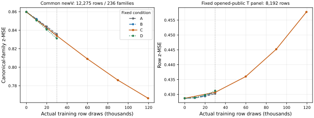
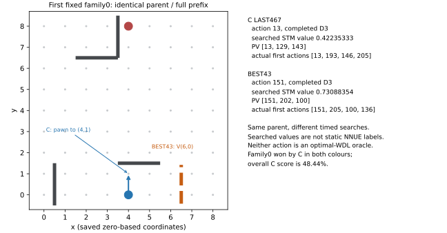

# 432：データ量・露出を変えた四学習と、事前選択Cの有限対局

共通newVで事前規則により選ばれた **C LAST467** は、BEST43相手に **185勝・2分・197敗、score 48.4375%** だった。192開始系列の二色平均を単位にした95%区間は **44.0104–52.8646%**。全384局・192組が完了したが、主判定「下限が50%超」は **NOT_MET**。このbook・100ms条件で改善は確認できず、劣位・同等性・一般棋力は認定しない。旧423/426/430の対局は合算していない。

学習では、Cの共通V誤差は継続して下がった。一方、公開Tの固定panel誤差は増え、公開VのLAST誤差も他三条件より大きかった。追加分布への適合と公開分布での誤差を両方残す結果である。BEST43、製品・generator既定、モデルの正式採用は変更しない。

## 四条件と事前選択

全条件は同じBEST43から独立fresh Adam、LR `1e-4`、最初10更新のlinear warmup、batch256、追加Tの左右反転確率.5、outcome zを使用した。教師・特徴・尺度は変更していない。A/B/Dは `0,39,78,117`、Cは `0,117,234,351,467` を観測した。

| 条件 | 実T distinct / 系列 | 学習draws | 更新 / 最終batch | 各行露出 | T指標の実panel |
| --- | ---: | ---: | ---: | ---: | ---: |
| A：小T | 3,735 / 796 | 29,880 | 117 / 184 | 8 | 全3,735 |
| B：大T・同draw数 | 14,940 / 811 | 29,880 | 117 / 184 | 2 | 固定8,192 |
| C：大T・8露出 | 14,940 / 811 | 119,520 | 467 / 224 | 8 | 固定8,192 |
| D：序盤寄りT | 3,735 / 149 | 29,880 | 117 / 184 | 8 | 全3,735 |

A/Bは同じdraw数での観察、B/Cは同じviewで学習量を変えた観察である。A/Dでは分布と系列数も変わり、「序盤だけ」の単独因果比較にはならない。同seedでも四条件の実順序・反転streamは別々に束縛した。Cの117更新目は全256行、BのLAST117は184行であり、BはCの途中状態ではない。

全newV **12,275行・236系列** を全観測点で評価した。公開Tは固定8,192行、既に開いた公開Vは419,150行を各LASTで一度測った。B/CのT指標は全14,940行の値ではなく、公開VのINITIAL値は今回測っていない。新しい集計項目は同じpredictionを再用した。

| 固定LAST | T panel行MSE | newV行MSE | newV系列平均MSE | 公開T panel行MSE | 公開V行MSE |
| --- | ---: | ---: | ---: | ---: | ---: |
| A117 | .803166 | .841530 | .835774 | .430241 | .425695 |
| B117 | .803329 | .839956 | .833927 | .430701 | .425904 |
| **C467** | **.739482** | **.773835** | **.766461** | **.457744** | **.453409** |
| D117 | .879581 | .837795 | .831157 | .431223 | .426614 |

共通INITIALのnewV系列MSEは `.8597406458724142`。Cは `.833927 → .809018 → .786041 → .766461` と低下した。公開T panelは `.428704 → .430702 → .436013 → .445196 → .457744` と増えた。これは公開VのINITIAL→LAST差を測ったことにはならない。

実native対応に全四LASTが有限範囲で適合した後、B/C/Dの**固定LAST・共通V系列MSE最小**という事前規則を適用した。Cが最小であり、Aは選択対象外。within-fit BESTや対局結果で選び直していない。選択に使ったVは独立な汎化確認ではない。

## 壁在庫・符号・飽和

newVの残壁層別は次のとおり。系列MSEは、その層に行を持つ系列の中で等重み平均する。複数層に同じ系列が現れるため、層の系列数は加算しない。

| 残壁合計 | 行 / 系列 | INITIAL系列MSE | A LAST | B LAST | C LAST | D LAST |
| --- | ---: | ---: | ---: | ---: | ---: | ---: |
| 16..20 | 584 / 75 | 1.056374 | 1.026279 | 1.026385 | .957607 | 1.029726 |
| 8..15 | 2,814 / 184 | 1.154052 | 1.119346 | 1.118093 | 1.025841 | 1.117634 |
| 1..7 | 7,867 / 232 | .868634 | .842361 | .840360 | .765653 | .835935 |
| 0 | 1,010 / 104 | .038399 | .041160 | .038995 | .036522 | **.032353** |

Cが全層で他条件より良いわけではない。壁0の系列MSEはDが最小だった。また、Cの高壁層ではMSEが下がっても、decisive符号正解はINITIAL `348/555` から `346/555` となった。

全newVのdecisive符号正解はINITIAL `8,481/12,151`（69.7967%）、C LAST `8,521/12,151`（70.1259%）。`abs(post)>=.9` は `5,162/12,275` から `3,845/12,275`、`.99` は `3,282/12,275` から `2,581/12,275` へ減った。MSE低下の全てを符号判断の改善とは扱えず、確信度の縮小も両立する説明である。Draw0の124行には符号正解を割り当てず、mean-absを別に保存した。

DのT全3,735行の高壁層は1,142行、Aでは322行だったが、Dの系列数は149、Aは796だった。この分布・系列の違いを保持する。全観測点の行/系列MSE、decisive/zero、Draw0、.9/.99飽和、T/newVの四層の分母は [curves.csv](../fit-analysis-v1/curves.csv)、[stock.csv](../fit-analysis-v1/stock.csv)、[endpoints.csv](../fit-analysis-v1/endpoints.csv) にある。公開データの系列・層対応がない範囲はUNKNOWNのままにした。

## 384局の結果と不確実性

4096件の一度のrules-only候補から、既存のLR/延長/endpoint collision-family ownerが3992系列を受け入れ、固定順の先頭192を使用した。104件のmissingは補充していない。既知の355/421/423/426/429/430 bookを除外したが、公開全域・sealed・任意の途中履歴への未露出までは証明しない。

| Cの色 | 局数 | 勝 / 分 / 敗 | score |
| --- | ---: | ---: | ---: |
| 0（開始STM） | 192 | 83 / 2 / 107 | 43.7500% |
| 1 | 192 | 102 / 0 / 90 | 53.1250% |
| 全体 | **384** | **185 / 2 / 197** | **48.4375%** |

二色系列の内訳は、C両勝35、1勝1敗114、両負41、1勝1分1、1敗1分1。2drawは保存棋譜の三fold到達と照合した。UNKNOWN、未完組、forfeit、engine error、合法fallbackは0。

事前固定の192系列に対し、PCG64・seed `43220261017`・10,000 resamples・linear percentileで**一度だけ**区間を計算した。平均 `.484375`、95% `[.4401041666666667, .5286458333333334]`、**NOT_MET**。complete-pair条件付き、valid-game、plannedの分母は今回は全て384局/192組に一致する。元の12個の16系列CIは別々に保存し、平均していない。

序盤長4/8/12/16の系列数は49/50/47/46、scoreは45.41/51.00/52.66/44.57%。これらと色別差は探索的記述であり、有利な層の選別、長さ変更、追加対局の根拠へ自動接続しない。A/B/Dの対局は実施しておらず、四条件の棋力順位は分からない。

[全192系列](families.csv)・[全384局](games.csv)・[実bootstrap](bootstrap-result.json)を保存した。実行source、score入力、設定、Python3.14.7/NumPy2.5.3、出力とPID寿命はその結果と `bootstrap-once-STOP.json` に束縛されている。統計関数の本文は凍結430とbyte exact。Python3.11と3.14のAST表現のhash差は、同じ3.14で新旧本文/AST一致を確認して区別した。

## 完成snapshot・時計・探索仕事

同じimage35e47e65/Build9bf66048、Control/PVS/TT1M/LMR depth_rank、100ms authority receipt・5ms reserve・1M安全node上限、近似/safe OFFで実行した。12操作は各32局・250Mの非移譲quota。全charged nodesは **1,670,199,748 / 3G** で、未使用quotaを貸していない。

| 記録の分母・仕事 | C LAST467 | BEST43 |
| --- | ---: | ---: |
| accepted / completed snapshot | 8,492 / 8,492 | 8,498 / 8,498 |
| 完成深さ 中央値 / 平均 / 範囲 | 9 / 11.3483 / 2..64 | 9 / 11.2696 / 3..64 |
| 色0 / 色1の完成深さ中央値 | 8 / 9 | 9 / 8 |
| whole-search nodes | 832,596,472 | 837,603,276 |
| selected-snapshot nodes（wholeに内包） | 592,185,146 | 591,507,262 |
| whole static evaluations | 424,728,568 | 427,040,776 |
| whole PVS再探索 | 206,295 | 191,411 |
| terminal LMR trial / normal-depth確認 / full-window | 32,620,655 / 191,778 / 2,280 | 32,927,510 / 170,178 / 1,989 |
| authority receipt遅延 | **0 / 8,492** | **0 / 8,498** |
| return / commitがdeadline後 | 2,228 / 2,528 | 1,135 / 1,228 |

全16,990件は合法な完成snapshotを期限内に受領し、matching terminalも回収した。return/commitの後期限は受領遅延と異なる。stopはinternal-time-limit 16,675、depth-cap281、reserve側cancel34であり、user取消や未完対局へ読み替えない。snapshot validation/engine/control errorは0だった。

完成深さはselective nominalで、色・軌跡・残壁の差を含む。残壁16..20/8..15の中央値は両モデル4、1..7はC8/BEST43 7、0では両20。深い終盤の尾部を棋力や原因へ読み替えない。LMR回数も枝ごとの順位・良否・削減の利益を表さない。

whole、selected、outer counterは重なるviewなので加算しない。TT retained bodyの83,886,128BはgaugeでRSSではない。arena `nn_calls=0` はinference-pump counterであり、NNUE物理head0の測定ではない。物理FT/head、連続RSS peak、孤立した評価器・TT・LMR時間はUNKNOWN。異なる軌跡・仕事のwhole時間からsame-work速度差を主張しない。

## 最初の固定系列の具体例

結果によらず最初のglobal family0、slot0/1を取り上げた。完全prefix `[131,145,93,204]`、STM0、残壁8/8、同じ5キーの完全履歴から始まる両色対局の最初の手である。

| 選択したモデル | 着手 | 完成深さ | searched STM値 | PV | snapshot / whole nodes |
| --- | --- | ---: | ---: | --- | ---: |
| C LAST467 | pawn `(4,0)→(4,1)` / 13 | 3 | .42235333 | 13,129,143 | 16,737 / 61,037 |
| BEST43 | V壁 `(6,0)` / 151 | 3 | .73088354 | 151,202,100 | 15,913 / 59,428 |

searched値を静的NNUE値や最適WDLとみなさない。完全履歴が同じでも、別のtimed searchで内部TT・ordering・受領時刻まで同一の介入比較ではない。この系列ではCが両色で勝ったが、全体scoreは48.44%だった。この一手が勝因/敗因という結論にはならない。

元参照はbatch000 `completed.jsonl.gz`（SHA709d0e60…）、line1 SHA9823e1a6…、line2 SHA0fd2d54f…。full prefix/history・PV・実続行8手・f32値bitsは [examples.json](examples.json) / [example-table.json](example-table.json) に保存した。

## 実仕事・失敗・停止と判断

四fitは実 **2,337,307 logical NNUE rows**（学習draw209,160を内包）、新しい四LASTのnative対応は各120、計480、合計 **2,337,787 <4M**。24 visited-state counter/モデル、18 child restore/モデルは有限fixture内の回数で、全入力の保証や96 unique状態ではない。arenaのSearch仕事は別の3G枠で計上し、fitの4Mへ混ぜていない。

既知の成功fit外側時間は4件合計16.630552319s、nativeは3.045859252s、arenaは1738.329555503sを各一度だけ計上する。nested operation/native/fit時計は加えない。元のA preentry FAILEDは0 forwardだが費用0ではなく、未取得の外側費はUNKNOWN。全source/LLM/admin費、全費用・連続peakもUNKNOWNのまま保持する。

元12 archiveは各一度だけstreamし、CRC EOF・raw SHA/bytes/32行・各行SHA・compressed SHA/size/modeの前後一致、global family/色/lineage/fullprefix/完全history/盤面/ply/終局/時計/typed evaluatorを照合した。family77の2局で出た初回の履歴フラグは配列順序だけで、完全なkey/count集合は一致した。元配列・元データ・初回フラグを保持している。

自分の初回lintのunused-import/E402、PNG previewのrsvg-convert欠如も別のFAILEDとして保存した。SVG生成/XML検査は完了し、成功したRAW読取・bootstrap・描画は再実行していない。補助読取が生成した旧430側のbytecode1個は特定して除去し、元ソースの不変を照合した。shared Main/sourceの変更はない。

今回の観測は、**追加Vの誤差を下げる学習が、そのまま固定時間の対局改善を保証しない**という有限結果である。公開分布とのtradeoff、Tの行/系列分布、異なる探索軌跡は競合する説明として残る。教師無効、学習不能、原因の一意特定、全般的な棋力低下は結論しない。追加fit/対局/seed変更/再選択を発行せず、元の有限試行の結果として引き渡す。

exact refs、元FAILED/UNKNOWN、実reader/helper directwait/reap/fresh identity・handles/TMP/leases・最終STOPとaffected usageは `completion.json` / `STOP.json` に集約する。leafは通常のowner acceptanceまでin_progressを維持する。
