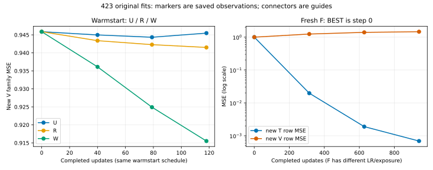
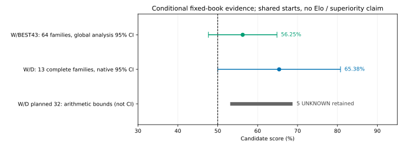
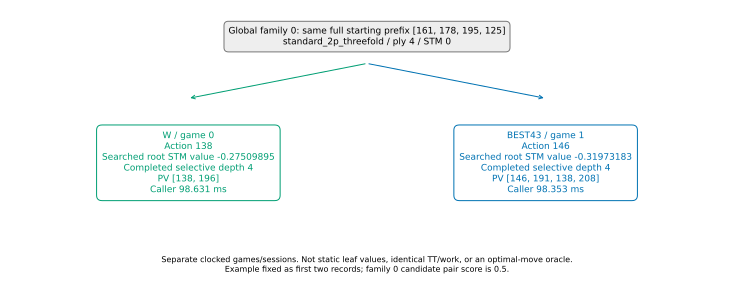

> 出版時補記：以下の64family区間は保存された分析者報告値である。独立確認では入力scores・設定・出力・一度の成功receiptを照合したが、実行されたchoice/quantile本体のsource参照はpacket内に束縛されておらず、実行bodyのprovenanceは未確認である。再計算は行わず、この制限を残して研究候補のみの結論を受け入れた。原分析本文・数値は以下にそのまま保持する。

原arena jobはFAILED、secondaryは5 UNKNOWNを残した有限結果である。保存済みの数値から、Wは新V family-MSEを約3.21%下げ、主要W/BEST43は72勝56敗・score56.25%だった。ただし真の64開始familyに対する保存解析95%区間は47.66–64.84%で50%を含む。改善の可能性を持つ研究候補として保持できるが、一般優越・非劣性・Elo・製品/既定昇格は支持しない。元の有限試行は負の結果とUNKNOWNを含め分析完了とし、追加fit/対局/補充は行わない。

今回の生成は原32＋真正未入場224の計256 requests、全GOAL。固定Sigma MCTS64 completed simulations/move、200ply、元モデル/codec/seedのまま。生成Sigma716901行と旧q1294行の合計718195は2M内である。64や256は効果量から導いた必要サンプル数ではなく、実pilot密度・費用・保存枠に基づく有限設計だった。旧成功分の再演、失敗枠の補充、教師品質低下、q教師への切替は0。

| 入力                              |                             実績 |
| --------------------------------- | -------------------------------: |
| 適格全行 / 最終T / V              |             12803 / 10305 / 2498 |
| canonical T / V family            |                         204 / 52 |
| 選択T / distinct選択入力          |                      3763 / 3763 |
| 適格T distinct入力                |                            10303 |
| 実用coverage128T/32V/distinct2048 | 達成、統計的十分性の保証ではない |
| 選択4096行の目安                  |              333行未達、補充なし |

pilot RAW/config/split/cacheは不変。全256の最終fit-viewではID18だけpilot VからTへ移ることを明示して結合した。prefix/schedule/global IDと実row game codeの対応は既存canonical ownerを使用し、結果による再partitionや新しいfamily classifierは作っていない。全評価開始bookは結果前の固定64family、生成T/Vからの通常入力分離を再利用した。

| 残壁層 | 適格T | 選択T |  全V |
| ------ | ----: | ----: | ---: |
| 16..20 |   320 |   314 |   76 |
| 8..15  |  2217 |  1183 |  558 |
| 1..7   |  6685 |  1632 | 1709 |
| 0      |  1083 |   634 |  155 |

高在庫の選択Tはstock16が293、17が21、18..20は0。Vも高在庫76行に限られる。4/8/12/16plyの開始を増やしたことを、序盤・高在庫全域の十分なcoverageとは呼ばない。公開データの欠けたgame/historyは保持し、sealed testは開いていない。

四条件はzSTM MSEだけを使う。U/R/Wは同じ凍結BEST43と入力正規化、fresh Adam、LR1e-4、同じ118更新・実30104訓練行。Rだけ43公開ファイルの順に0.92^(43-i)でrow samplingを重み付けする。ファイル順の減衰を、世代の強さや古い教師の弱さの証明にはしない。Wは新Sigma zのみ。Fは同じ新Tと共通入力正規化を使うfresh初期化、LR1e-3、941更新・240832訓練行であり、初期重みだけの比較ではない。

| 条件                       | BEST / LAST | 新V family-MSE 初期→BEST | 新V row-MSE BEST | 公開fullV MSE、BESTだけ |
| -------------------------- | ----------- | ------------------------ | ---------------- | ----------------------- |
| U：全43公開T               | 79 / 118    | 0.945876→0.944336        | 0.981644         | 0.423886                |
| R：同公開T、ファイル順減衰 | 118 / 118   | 0.945876→0.941504        | 0.980087         | 0.423965                |
| W：新Sigma zのみ追加       | 118 / 118   | 0.945876→0.915511        | 0.955989         | 0.425681                |
| F：fresh初期化             | 0 / 941     | 1.000000→1.000000        | 1.000000         | 1.000000                |

全16観測点はcurves.csv、52familyごとの変化はfamily-MSE-changes.jsonに保持した。family-MSEは各family内のrow-MSEの非加重平均で、row全体のMSEとは分母が違う。BESTは同じ52新V familyの最小値・同点早いstep。選択に使ったVの改善を、独立確認やpopulation testに読み替えない。公開fullV419150行は各distinct BESTに一度だけ、curveのpublicV nullは設計上の未測定である。

Wの新T row-MSEは0.871007→0.824278、新Vも改善したが、公開Vにはtrade-offがある。Wの新V family別は29改善/23悪化で、一律改善ではない。W BESTのV層別MSEは高在庫から1.159371 / 1.078505 / 0.974814 / 0.207640、各分母は表のV行数である。全層・10bin calibrationは保存resultへ結び、有利な部分群から有意性を作らない。

F BEST0は実際のfresh initial modelであり、旧BEST43のaliasではない。F LASTでは新T MSE0.000690まで下がる一方、新V row-MSE1.463406、family-MSE1.488976へ悪化した。この一設定での訓練と汎化の隔たりを示す。教師無効・fresh学習不可能・データ数十分とは結論しない。W/Fの平均露出は8/64相当で、LR/更新/初期化も異なる。個々のvisit配列は今回decodeせず、実total/distinct/repeated counterと原保存参照を保持する。

Rはnative fit COMPLETEでも原operation FAILEDのまま。Rootが存在しないローカルINITIALファイルを宣言したことが原因で、実U INITIALの同一FileRef/同一step0 metricsをR/Wが共有していた。原FAILEDをretroPASSしない。Uの二つの初期化前FAILEDはforward0、変更重み対応のaffinity事前拒否はheads0として原状保持した。

四fitは訓練331144＋測定1878942＝2210086 logical NNUE行。bankは新T3763＋新V2498＋公開T8192＝14453行で、R/WのINITIAL実共有2回を除く14×14453＋BEST公開V4×419150＝測定1878942と一致する。selected U/R/W/Fのnative full/delta/factory/parent restorationは各120、計480 heads、総2210566 < 4M。Fのnative対応対象はselected BEST0であり、LAST941まで別途native資格を確認したとはしない。arenaの探索仕事は別1G枠で、この訓練forward数へ隠していない。

arenaは元の同image、Control/PVS/TT1048576、LMR ON-depth_rank、100ms authority receipt/5ms reserve、1M nodes/turn、depth64、200ply。近似/safe leafは元scopeでOFF。actual kernel SHAは35e47e65、W typed contentは8a8eb7fb、BEST43は96a5f41f、Dはc83db10bで、各operationの実config/evaluator-identitiesと一致する。モデル/特徴/本番既定を変更していない。

| 対照         | 予定 / started / GOAL | W-D-L   | UNKNOWN |  完了family | scoreと範囲                                   |
| ------------ | --------------------- | ------- | ------: | ----------: | --------------------------------------------- |
| 主要W/BEST43 | 128 / 128 / 128       | 72-0-56 |       0 |          64 | 56.25%、全64解析95%区間47.66–64.84%           |
| 副次W/D      | 32 / 28 / 27          | 17-0-10 |       5 | 13、未完了3 | pair条件付き65.38%、native95%区間50.00–80.77% |

primaryの64familyは両勝ち20、片勝ち32、両負け12。色別WはP0が35/64、P1が37/64。native表示名は各chunkで0..15を再使用しており、名前だけでは16へ誤集約する。global schedule family ID＋完全prefix＋lineageで64へ結合し、全160slotを原games.csvと照合した。families.csv/games.csvに全系列・両色の分母を保持する。副次は同じ先頭16開始系列であり、80pairや160gameを独立標本数へ水増ししない。

primaryの新しい全64解析区間は、既存NumPy2.5.3のGenerator.choice/mean/quantileを使い、元seed42320261027、10000 resamples、family pair score単位、95% percentile/linearで一度だけ計算した。原native chunkの16family区間は保持し、平均・連結していない。解析のPCG64はnativeの乱数実装と別なので、native byte-exact区間とも呼ばない。固定bookと交換可能なfamilyを仮定した記述的区間で、系統依存・checkpoint選択・一般化を補正した保証ではない。

secondaryは17/26＝13完了pairの平均65.38%と、17/27＝全完了game score62.96%を区別する。予定32gameに対する欠測込み算術範囲は17/32..22/32＝53.125–68.75%で、CIでもUNKNOWNへ勝敗を付けた結果でもない。欠測はfamily13の片色、14/15の両色。原Unclassified5は1 started＋4未入場、global common_total_node_capは別scopeの終了理由として残す。各UNKNOWNを個別NodeLimit等へ再分類しない。順序・費用に依存する欠測なので、13完了pair条件付き値を全予定・一般棋力へ外挿しない。

primaryは元800Mを4つの32slot/200M操作へ分け、secondaryは元32slot/200Mのまま。global family/colour/prefixは変更せず、local game/batchだけ対応付けた。総charged nodes752662738 < 1G、primary未使用247337262はsecondaryへ貸していない。chargedにはopaque予約を含み、正確なvisited nodesやNNUE物理forward数ではない。terminal/selected/TT等の内包する仕事やgaugeを加算しない。

原outer b495b1c5はFAILED/exit1、最後のoperation/dataはFAILED・cleanupfalse、native processはcleanuptrue、全original IDsは別に停止・直接reap済みである。これらのscopeを混ぜない。モデル読込前のdisabled field parse拒否とper-game retained_outcome_bytes誤scopeのforecast拒否、最後のcollector serialization assertion失敗も原captureを保持した。disabled falseのnative serde省略だけの差を補正したcollectionを使い、source/画像/数値を再実行していない。

具体例は結果を見る前に原primary最初の2recordsを固定したglobal family0、完全prefix [161,178,195,125]、ply4/STM0。

| 保存snapshot        | 着手 |  root STM値 | 完成深さ | PV              |   caller |
| ------------------- | ---: | ----------: | -------: | --------------- | -------: |
| W、local game0      |  138 | -0.27509895 |        4 | 138,196         | 98.631ms |
| BEST43、local game1 |  146 | -0.31973183 |        4 | 146,191,138,208 | 98.353ms |

両方acceptedでauthority receiptはdeadline前。値は各自の選択手に戻ったsearched root snapshotで、static葉値・全幅minimax・最善手oracleではない。完成depth4も選択的名目深さ。別game/role/時計で、TT/killer/history/scratch/仕事量の同一性は主張しない。実続行はいずれも色1のgoalとなり、このfamilyのW二色scoreは0.5だった。都合の良い勝例へ補充していない。RAW参照/原行SHA/前後prefix・実続行/selectedとwhole workはcandidate-example.jsonに保存した。新しいRAW decodeはこの2recordsだけで、155game全部のper-move fallback/error/遅延/深さ分布を再監査していない。compact正本にない全件値はUNKNOWNを保持する。

旧qは原12敗戦から固定選択した28局面、全64sim完了、Sigma論理/物理/実行各1294、warm/failed0。terminal_no_nn498はMCTS内部counterで、勝敗数ではない。全28表はold-q-table.json。先頭の383-case08-ply011では、同じ完全prefixに対し原NNUE action156/V(d2)、完成D3のsearched value+0.95947003、現在Sigma MCTS64 action68/q+0.097117811、同Sigma static root -0.005028306だった。評価器・探索・時間/予算・値の由来が異なり、元敗因やSigmaの正しさを認定しない。現在Wをその同じ葉で評価したわけでもなく、qをfitへ入れていない。

把握した原outerは各一度の計4075.3522956439992s。内訳はresult.jsonに原FAILEDを含め保持し、W/F共有outer、pilot再用、nested nativeを重複加算していない。主な生成はpilot422.156219644s＋suffix2836.099146673s、元arenaは716.676771327s。全software/source/LLM/admin、continuous family RSS、物理FT/NN、孤立部位費を含む総費用はUNKNOWNである。native reportのper-process peak RSSを足してfamily peakにせず、whole-clockをsetup・Search・journal・drop等の内包時計と重ねて足さない。

今回が支持するのは「新Sigma zで追加したWは新分布の検証lossを下げ、固定bookで小さい正の棋力点推定を観測した」という有限な範囲である。W研究候補と原成果を保持し、U/R/Fの追加比較や再選択・正式昇格はしない。Fの大きなtrain/V乖離、高在庫の薄さ、公開V trade-off、主要区間の幅、副次の打切りを同時に残す。

優先する次の提案は、追加fit/teacher変更より先に凍結Wの独立開始系列での確認を設計すること。一例として今回のfamily分散が続くという計画仮定なら約192family pairs/384gamesで正規近似半幅約5ptを狙えるが、効果・独立性・十分性の保証ではなく、今回160/1Gの枠外で未発行である。同じ初期局面の反復を独立系列へ増算しない。NNUE自己対局やq+z教師は別の設計判断であり、この報告から実行しない。

checks.jsonの算術/分母/identity照合、限定Ruff/Prettier、図の目視確認を実施する。原selected refsのSHA-size-mode前後・最終stable、実reader/helper STOP・直接wait/reap・fresh identity・handles/TMP/leases/owned[]、一回の本人usageはcompletion/STOP/usageに束縛する。新forward/fit/Search/対局/solver/build/旧suite再演やAstra/新session/委譲は0。本人423.1はin_progressで通常のowner acceptanceへ返し、Root324が必要な423.4の限定確認・Main出版・統合を行う。人間/Root ACKや親closeを入口にしない。全legacy USERPAUSE/defaults/models/weights/seals/oldfits96/foreign/RAW/FAILED/費UNKNOWNは不変。
