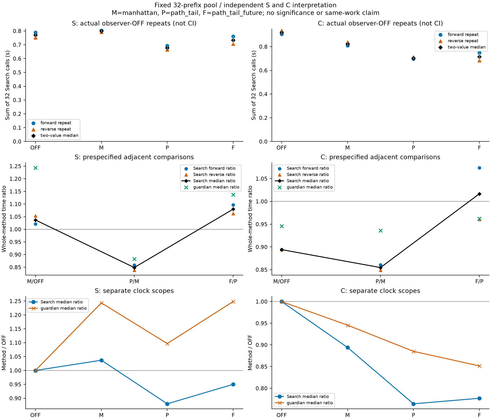
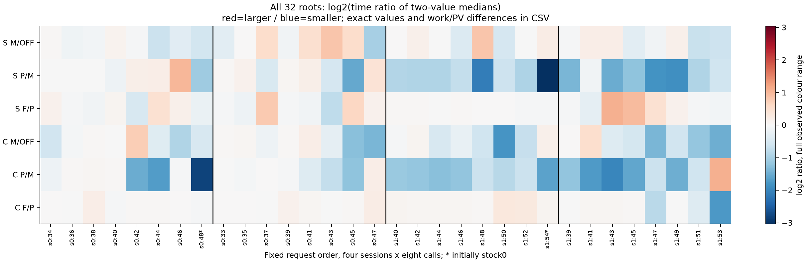
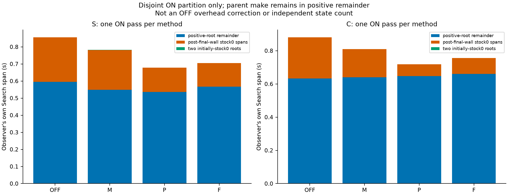

# 追加学習後の両NNUE：終盤打ち切り4条件の有限比較

2026-10-18。原24pass/768callの保存解析と同じHighの独立結論確認（conclusion_clear=true、blockers0）を受けた正式報告。原解析・計測source/image・RAW・失敗を保持し、整理後sourceや現在のMainへ実測資格を付け替えない。

通常研究既定は**最短経路による確定判定（path_tail）を維持**する。固定32prefixのSearch合計で駒間距離による確定判定よりS15.14%／C14.53%短かったが、局所悪化S8／C6rootも残る。**最短経路＋履歴条件の緩和（path_tail_future）は通常選択へ追加採用しない**。既存の明示研究optionと正しさは保ち、この比較から全用途で無効とは判定しない。

この判断は独立確認前の暫定研究判断と、その後に届いた有限結論clearを区別して記録した。旧434の別cohortは改稿・合算しない。後続の三対照棋力評価は明示OFF/manhattanの別条件で、今回のSearch比を対局ETAや棋力へ換算しない。

| 正式名称                               | 原記録の識別子       |
| -------------------------------------- | -------------------- |
| 打ち切りなし                           | OFF                  |
| 駒間距離による確定判定                 | manhattan / M        |
| 最短経路による確定判定（通常研究既定） | path_tail / P        |
| 最短経路＋履歴条件の緩和               | path_tail_future / F |

SはSigma静的教師NNUEの追加学習後BEST、CはClaustrophobia静的教師NNUEの追加学習後BESTで、異なる教師targetのMSE・別評価器の絶対clockから棋力や教師優劣を判断しない。

この32-prefix poolのobserver OFF Search合計では、**path_tail/manhattanはSで15.14%、Cで14.53%小さかった**。一方、path_tail_future/path_tailの比はSで1.0797、Cで1.0167で、追加の履歴条件緩和の実用利益をこの比較では確認できなかった。これは原pool・原clockの記述であり、一般速度・棋力・teacher優越・同じ仕事量のthroughputやpredicate単独の因果効果ではない。

## 実scopeと主要比較

原job `0da4692a`、24操作、768/768 COMPLETE、UNKNOWN0、全てLMR depth_rankの**selective nominal D8**。96session lifetime、visited nodes14,887,179は3,072,000,000上限内。32 fullprefix/historyのpoolは2系列、4session×8時系列prefixで、26 board keyを含む。32独立ゲームとは扱わない。各passで4sessionを新設し、同sessionの8入力ではTT/orderingを保持し、pass間では全て破棄した。warmup/refill/追加rootはない。

M=manhattan、P=path_tail（通常研究既定）、F=path_tail_future。Sは新BEST34297/weights845e2bd0/typed01503f59、Cは新BEST58305/35cbb976/typedeb0fbc93。両者のlow-LR practical plateauと、旧32R NOT_CONVERGEDは別結果である。実BUILD1c89df77/imageffcb342e、実行source63727475＋frozen patchを参照する。現在のMain/sourceがそのままという主張はしない。

| NNUE | 比較                       | raw比1 | raw比2 | Search中央値比 | 変化%  | guardian比 | nodes比  | 局所>1/32 |
| ---- | -------------------------- | ------ | ------ | -------------- | ------ | ---------- | -------- | --------- |
| S    | manhattan/OFF              | 1.0214 | 1.0531 | 1.0369         | 3.69   | 1.2434     | 0.901568 | 14        |
| S    | path_tail/manhattan        | 0.8585 | 0.8385 | 0.8486         | -15.14 | 0.8822     | 0.839938 | 8         |
| S    | path_tail_future/path_tail | 1.0966 | 1.0621 | 1.0797         | 7.97   | 1.1378     | 0.999894 | 16        |
| C    | manhattan/OFF              | 0.8940 | 0.8942 | 0.8941         | -10.59 | 0.9455     | 0.875915 | 10        |
| C    | path_tail/manhattan        | 0.8605 | 0.8492 | 0.8547         | -14.53 | 0.9362     | 0.827991 | 6         |
| C    | path_tail_future/path_tail | 1.0738 | 0.9607 | 1.0167         | 1.67   | 0.9620     | 0.999952 | 22        |

比は小さいほどその測定clockが短い。raw比1はforward同士、raw比2はreverse同士。中央値比は各32呼出し合計の二値中央値同士であり、root比の平均ではない。M/OFFはSでは遅くCでは短く、基本判定も一様な改善ではない。F/PではCのraw比1は1.0738、比2は0.9607と向きが異なる。2反復から小差の有意性や一般再現性を認定しない。

## raw反復と全手法/OFF

| NNUE | method | Search1秒 | Search2秒 | 二値中央値秒 | 反復幅/中央値% | Search/OFF | nodes1=2 |
| ---- | ------ | --------- | --------- | ------------ | -------------- | ---------- | -------- |
| S    | OFF    | 0.790117  | 0.752565  | 0.771341     | 4.87           | 1.0000     | 700572   |
| S    | M      | 0.807047  | 0.792555  | 0.799801     | 1.81           | 1.0369     | 631613   |
| S    | P      | 0.692842  | 0.664539  | 0.678691     | 4.17           | 0.8799     | 530516   |
| S    | F      | 0.759787  | 0.705838  | 0.732813     | 7.36           | 0.9501     | 530460   |
| C    | OFF    | 0.905614  | 0.936319  | 0.920967     | 3.33           | 1.0000     | 772381   |
| C    | M      | 0.809610  | 0.837277  | 0.823444     | 3.36           | 0.8941     | 676540   |
| C    | P      | 0.696639  | 0.710996  | 0.703817     | 2.04           | 0.7642     | 560169   |
| C    | F      | 0.748021  | 0.683087  | 0.715554     | 9.07           | 0.7770     | 560142   |

反復幅はmax−min。confidence intervalではない。S/Cはそれぞれの同じ模型内で読み、異NNUEの絶対clockからteacherや強さを順位付けしない。全32root、2系列・各色sessionのraw合計と局所比をCSVへ保存した。局所>1のrootを除いて全体を再計算していない。

## whole clockは別の結果

| NNUE | method | guardian1秒 | guardian2秒 | 二値中央値秒 | guardian/OFF |
| ---- | ------ | ----------- | ----------- | ------------ | ------------ |
| S    | OFF    | 1.123489    | 1.133964    | 1.128727     | 1.0000       |
| S    | M      | 1.556771    | 1.250235    | 1.403503     | 1.2434       |
| S    | P      | 1.375901    | 1.100580    | 1.238241     | 1.0970       |
| S    | F      | 1.329356    | 1.488488    | 1.408922     | 1.2482       |
| C    | OFF    | 1.284653    | 1.272278    | 1.278465     | 1.0000       |
| C    | M      | 1.221519    | 1.196158    | 1.208838     | 0.9455       |
| C    | P      | 1.106650    | 1.156784    | 1.131717     | 0.8852       |
| C    | F      | 1.164532    | 1.012824    | 1.088678     | 0.8516       |

native guardian wallには、実際の入力準備・session構築・Search・journal/serialization・drop/exit等がその境界内で含まれる。nativeのbefore-result-publication/driver clock、setup/reset/drop/journalは `pass-summary.csv` に別保存した。これらnested clockを足してwholeや原outerへ加算しない。

SのP/OFFはSearchでは小さくてもguardianでは約1.097で、wholeでは一様な短縮ではない。CのF/PはSearch比1.0167に対しguardian比0.9620で逆方向である。`guardian−Search` と `guardian−before-publication` は符号付きの未帰属scope差として残し、厳密な汎用overhead補正や全要素の加算closureはUNKNOWNとする。

## root別・非clock照合

OFF反復1/2、ON/OFF1、ON/OFF2の計768 row-pairを比べ、記録された非clock projectionは**768一致、0不一致**。root key/full counted history/ply/rulesのdigest、request順・session・TT generation、value bits・action・PV・work・root合法集合・parent_unchangedを含む。比較から外したのはSearchの二clockとobserver専用stock_observationで、work差を都合よく削っていない。元inputのliteral履歴・prefix pointerも照合したが、rules/PV全ply/FT undoを新しく再生したわけではない。FTの各遷移証明は保存projectionに独立にはなく、source/native境界の証拠に依存する。

異手法ではtree/work/value/PVが変わる。P/Mでvalue bitsが変わるrootはS9/C8、PVはS14/C14。一方F/Pのroot value bitsとPVは全32で一致したが、nodesはSで56、Cで27だけ少なく、同じ仕事そのものとは呼ばない。局所regressionと全値は `root-comparisons.csv`、全768callのworkは `call-metrics.csv` に保存した。

以下は前もって固定した順序の先頭positive rootと、最初のinitial stock0 root。短いclockを選んだ追加実験ではない。厳密なaction/value/PV差は同じCSVの対応行と原native JSONにある。

| NNUE | 固定例          | 残壁合計 | OFF ms | M ms   | P ms   | F ms   |
| ---- | --------------- | -------- | ------ | ------ | ------ | ------ |
| S    | series-0-ply-34 | 2        | 62.364 | 64.290 | 63.270 | 69.513 |
| S    | series-0-ply-48 | 0        | 0.506  | 0.346  | 0.164  | 0.142  |
| C    | series-0-ply-34 | 2        | 94.402 | 63.334 | 56.728 | 57.399 |
| C    | series-0-ply-48 | 0        | 0.522  | 0.373  | 0.053  | 0.051  |

## ON：stock0の境界と分母

| NNUE | method | positive30の観測秒 | stock0子区間秒 | 同割合% | positive残秒 | 初期stock0の2root秒 | maximal区間数 |
| ---- | ------ | ------------------ | -------------- | ------- | ------------ | ------------------- | ------------- |
| S    | OFF    | 0.855201           | 0.259475       | 30.34   | 0.595726     | 0.000956            | 139631        |
| S    | M      | 0.780833           | 0.232293       | 29.75   | 0.548539     | 0.001216            | 139259        |
| S    | P      | 0.678193           | 0.142255       | 20.98   | 0.535938     | 0.000126            | 134853        |
| S    | F      | 0.704651           | 0.137696       | 19.54   | 0.566955     | 0.000101            | 134853        |
| C    | OFF    | 0.880122           | 0.247538       | 28.13   | 0.632584     | 0.000993            | 89657         |
| C    | M      | 0.808902           | 0.168195       | 20.79   | 0.640707     | 0.000775            | 86884         |
| C    | P      | 0.718386           | 0.071463       | 9.95    | 0.646923     | 0.000221            | 81725         |
| C    | F      | 0.755568           | 0.095864       | 12.69   | 0.659705     | 0.000235            | 81725         |

各ON passの分母を、**initial positive30 root**と**initial stock0の2root**に分ける。positive側はcanonical final-wall make完了後から元parent復元完了までの、最大かつ非重複のstock0区間である。postmakeのfingerprint/path/FT/Search/undo-parent restorationを囲むsource契約のclockで、parent make自体は含めずpositive remainderへ残す。個々のfingerprint/FT等の時間は分離していない。最初からstock0の2rootには架空のfinal-wall eventを作らず、whole Search spanを別欄に置く。

表はobserverの独自 `observed_Search_seconds` による分解。main `Search_call_seconds` との差もCSVに符号付きで保存した。positive観測時間−子区間−positive remainderの最大絶対残差は1.11e-16秒、failed stock0 regionは合計0。負の値を0へclampせず、nested区間を再加算しない。区間数は実行区間であって、独立局面数・unique state・未探索node削減数ではない。

| NNUE | method | fresh手法return counter和 | typed safeTT return | proven leaf counter | 前二者との一致 |
| ---- | ------ | ------------------------- | ------------------- | ------------------- | -------------- |
| S    | OFF    | 0                         | 0                   | 0                   | True           |
| S    | M      | 29071                     | 5082                | 34153               | True           |
| S    | P      | 43068                     | 11644               | 54712               | True           |
| S    | F      | 43094                     | 11644               | 54738               | True           |
| C    | OFF    | 0                         | 0                   | 0                   | True           |
| C    | M      | 27878                     | 5320                | 33198               | True           |
| C    | P      | 38105                     | 11893               | 49998               | True           |
| C    | F      | 38128                     | 11893               | 50021               | True           |

fresh手法return counter和、typed safeTT return、proven-leaf counterを別に残す。geometry passは履歴資格前の値を含み、証明数ではない。Fのfresh/TT returnにも旧条件で既に資格がある状態が含まれ得る。**追加E-nonempty/Q-only資格の帰属はUNKNOWN**。旧predicate再演・全履歴scan・map追加は行わない。ONは別の新鮮なpassであり、ON−OFFを正確なobserver overheadとして差し引いたり、ON区間比をOFFの測定節約量へ変換しない。

## 費用・失敗・保存

原comparison outerは **274.683299782046秒を一度だけ**計上する。24 native guardian合計29.122246760991秒と768 Search合計18.479446756000秒はそのnested情報で、加算しない。outer−native合計の未帰属差は245.561053021054秒。個別native exit UTCは保存されておらずUNKNOWN。最後のoperation finalized01:56:14.890768Z、outer STOP01:56:15.079644Z、producer/collector実release02:02:12.220202Zは別の境界である。

reset snapshotのTT1Mは83,886,128B/session。これはTTのcapacity/retained metadataで、process RSS、family2GiB guard、物理NNUE FT/head、連続peakとは別である。physical counts/continuouspeak/full feesはUNKNOWN。

元collector-v1のunusedsettings Ruff拒否・NULL-vs-disk、保存だけのcollector-v2、原readyNOT_SUBMITTED/caller-before-afterを保持する。それらを現在のMain同一性や新しい実行成功に読み替えない。今回の独自preflight-v1のAPI name不足とv2の未作成Root numeric扱いによるFAILEDも別保存し、科学再実行はゼロ。通常storage observerのadmission UNKNOWNは変更せず、明示4rootの点と未作成rootの観測を残す。新分析物は既発行6の134,217,728B wholeの `results-v1` 内に置き、7や旧quotaを借りずsupportを再適用しない。

入力と48 native JSON/settingsの実FileRef、archive index、当該source/interpreter、全CSV・PNG/SVG・チェック・STOPは成果packetに束縛する。元24archiveのCRC/rawSHA検査やgzip/RAW decodeは再実行していない。一般棋力・同値性・小差検出能力・モデル昇格の結論はなく、現在のpath_tail既定を変更する根拠としてこの有限比較を拡張しない。比較専用sourceの後処理は、共有imageを使う6/7の実STOP後にRootが別途扱う。

最終packet整備のhelper-v1はFileRefの付加属性stableを本体identityと比較して拒否された（0.14950623700860888秒）。SHA/bytes/modeは一致し、比較キーと未実行の出力escapeだけを修復したv2で完了した。原FAILED/実PID/cleanupを保持し、分析・図・科学実行は繰り返していない。

## 実設定・独立確認・再構成元

Control/PVS、TT1,048,576、LMR ON depth_rank、旧近似OFF、selective nominal depth8、各呼出し4,000,000nodes、時間上限なし。各条件のenable/methodとobserverを明示した。requested seed32462018はprovenanceのみで、現SearchControlにRNG入口はなくeffective seedはnullである。

独立Highは凍結表のscalar/join1382件と残りseries60/counter8件を確認し、不一致0。保存3PNGの表示を確認し、NumPy/RNG/plot再描画・モデル/head/native/Search/fit・RAW/archive再読・旧成功suiteの再演はない。非clock一致は保存projectionとsource/receiptの範囲で、PV全ply・FT全遷移・geometry/historyを再生した資格ではない。

原outerとnativeの差245.561053021秒は未帰属のまま残す。待機・guard・import等へ推測で帰属せず、この報告から別の性能調査jobを発行しない。比較専用診断sourceの整理は同じimageを使う6/7両実consumer STOP後に行い、今回のgenuine imageと結果を保全する。

完全なFileRef（SHA256・bytes・mode）、実行source/environment、元入力・設定・native結果・全CSV・図・STOPへの参照は[公開receipt](receipt.json)と[原成果completion](../../../.worktree/assets/perf/post-low-lr-endgame4-analysis-v1/results-v1/completion.json)に保存した。[原日本語解析](../../../.worktree/assets/perf/post-low-lr-endgame4-analysis-v1/results-v1/report-ja.md)、[独立確認](../../../.worktree/assets/perf/post-low-lr-endgame4-review-v1/final-results-v1/review-ja.md)、[受入れ](../../../.artifacts/research-team/integration324/post-low-lr-endgame4-v1/saved-result-acceptance-v1.json)を参照する。
