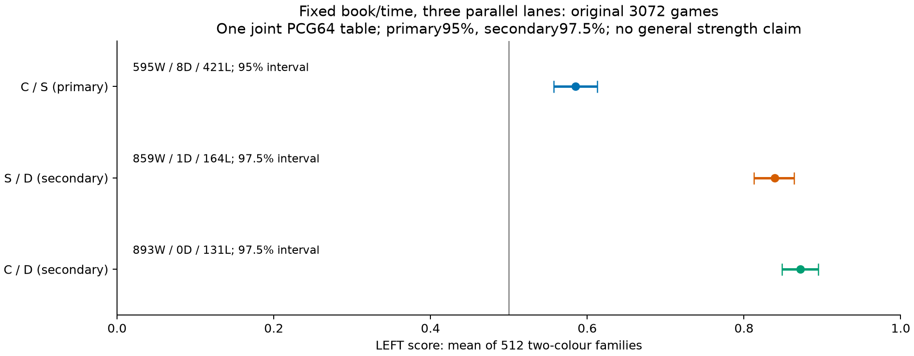
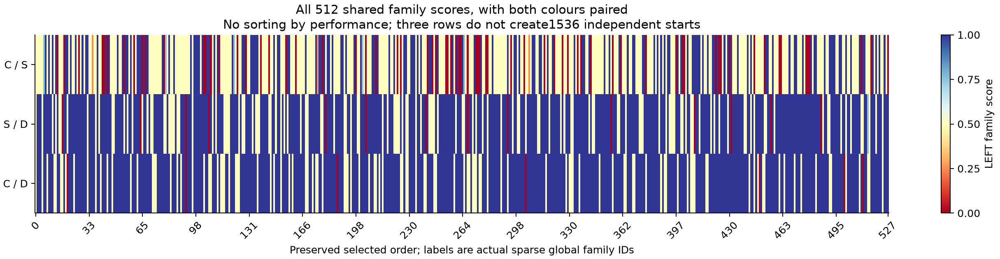
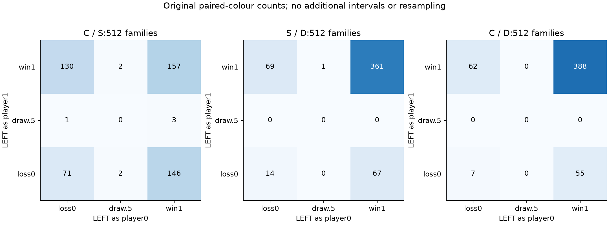

# 追加学習後NNUEの直接対局と固定D：3対照の有限棋力評価

2026-10-18。CはClaustrophobia静的教師NNUE、SはSigma静的教師NNUEであり、低LR継続後に固定own-V最小で選択した新BESTを指す。Dはnative-owned a0b8tanhの固定評価器である。主要な問いはC対Sの直接成績、副次の問いはそれぞれの固定Dに対する成績とした。

本報告は元の3072局と一度の保存解析を公開する。現役model/defaultの採用変更ではなく、最終確認と完全な原参照は[保存receipt](receipt.json)から追える。整理後MainのsourceはUNMEASUREDであり、ここで実測したimageとは区別する。

**固定newbook・100ms/5ms・3lane並列条件では、直接C/SはCを支持した。** C/Sは595勝8分421敗、score0.5849609375、予定した95% family区間[0.55712890625,0.61279296875]で下端が0.5を上回った。主対照が解決したため、副対照の階層が開き、S/D・C/Dも予定の97.5%区間でそれぞれLEFTを支持した。

これは凍結した二NNUEと固定Dを現image・このbook/clockで比較した結果である。教師一般の優越、単独の学習因果、旧32Rからの純粋改善、Elo、同等性、製品model/default昇格を認定するものではない。C/Sの結論を共通Dの二結果から推定していない。

同じHighによる保存結論の独立確認は `conclusion_clear=true / blockers0 / ordinary0`（control `7abc607b`）。元3072局・family/色/sourceの整数joinと、一度の統計実行の対応を確認し、新しい対局・RNG実行・RAW再抽出は行っていない。

## 全体結果と元の判定規則

| LEFT / RIGHT | W-D-L     | 完全family | score       | 区間                             | 判定範囲               |
| ------------ | --------- | ---------- | ----------- | -------------------------------- | ---------------------- |
| C / S        | 595-8-421 | 512        | 0.584960938 | 95% [0.557128906, 0.612792969]   | LEFT支持・固定条件のみ |
| S / D        | 859-1-164 | 512        | 0.839355469 | 97.5% [0.812988281, 0.863769531] | LEFT支持・固定条件のみ |
| C / D        | 893-0-131 | 512        | 0.872070312 | 97.5% [0.848632812, 0.894531250] | LEFT支持・固定条件のみ |

原96操作・3072局はすべて開始・完了、UNKNOWN0、goal3063/draw9。各対照は1024局・512完全二色対である。**統計上の単位は共有512 canonical family**であり、1536 family対や3072局を独立開始数とは扱わない。全対照の完全family平均・valid-game score・planned boundsは今回は一致する。各対照の予定boundsは上表scoreと同じ一点で、missingを除いた区間へ置換したものではない。

主C/Sは完全1024局/512familyを条件に95%下端>0.5ならC支持、上端<0.5ならS支持、それ以外は未解決とする原規則を適用した。副S/D・C/Dは各97.5%の両側区間を使う。主alpha.05→副各alpha.025のBonferroni階層であり、nominal familywise.05はbootstrap近似coverageが妥当という条件付きである。exactな有限coverage保証ではない。三対照は結果にかかわらず全件実行・表示する設計で、途中打切りや追加局数・閾値選択はない。

## 入力・色・局所対応

新8192 rules-only候補の最初の512 eligible canonical familyを結果前に凍結したbookを使用した。解析はnativeのLR/extension/endpoint分類を再実装せず、保存された実ID・canonical family hash・全prefix・counted history・request/lineage・LEFT色を結合した。実global IDは0..527の疎な集合で、book ordinalと異なるものは492件。表示名やdense連番でfamilyを潰していない。

32block×各16familyに対し、contrast_index=(block+lane)%3という固定割当を確認した。各laneは元32操作を独立進行し、block名は同時開始・完了のbarrierを意味しない。各対照はlaneに11/11/10操作で均衡する。共有cache/bandwidth/frequency変動は人間が受け入れた並列cohort条件であり、直列equivalenceや理想3倍速を測ったものではない。

| 対照  | LEFTの色 | W-D-L     | 局数 | score       |
| ----- | -------- | --------- | ---- | ----------- |
| C / D | 0        | 443-0-69  | 512  | 0.865234375 |
| C / D | 1        | 450-0-62  | 512  | 0.878906250 |
| C / S | 0        | 306-4-202 | 512  | 0.601562500 |
| C / S | 1        | 289-4-219 | 512  | 0.568359375 |
| S / D | 0        | 428-1-83  | 512  | 0.836914062 |
| S / D | 1        | 431-0-81  | 512  | 0.841796875 |

| 対照  | family0 | .25 | .5  | .75 | 1   |
| ----- | ------- | --- | --- | --- | --- |
| C / S | 71      | 3   | 276 | 5   | 157 |
| S / D | 14      | 0   | 136 | 1   | 361 |
| C / D | 7       | 0   | 117 | 0   | 388 |

各family内の二色は相関し、0.5には勝敗splitも含まれる。drawを人工的な欠測や勝敗へ変換していない。全512family×三対照の両色scoreは `family-scores.csv`、全3072行は `games-scores.csv`、全96操作は `operations.csv` に保存した。

## source/prefix別の記述

| pool内source split | prefix長 | family数 | C/S score | S/D score | C/D score |
| ------------------ | -------- | -------- | --------- | --------- | --------- |
| train              | 4        | 100      | 0.645000  | 0.750000  | 0.815000  |
| train              | 8        | 101      | 0.559406  | 0.886139  | 0.930693  |
| train              | 12       | 100      | 0.580000  | 0.885000  | 0.895000  |
| train              | 16       | 100      | 0.565000  | 0.822500  | 0.865000  |
| validation         | 4        | 27       | 0.592593  | 0.777778  | 0.685185  |
| validation         | 8        | 29       | 0.637931  | 0.879310  | 0.931034  |
| validation         | 12       | 26       | 0.548077  | 0.884615  | 0.923077  |
| validation         | 16       | 29       | 0.525862  | 0.862069  | 0.879310  |

このtrain/validationは**rules-only候補poolのsource partition**であり、教師publicT/Vの資格ではない。元publicのゲーム履歴・prefix内部の過去露出・任意のinterior inputとの非重複はUNKNOWNのまま。原ゲーム/series識別も供給metadataにはなくUNKNOWNであり、prefix長やsource splitを独立ゲーム系列へ読み替えない。この表は元のsource/local報告で、追加CI・panel採否・有利な開始の再選択はしていない。全32block別結果も `block-summary.csv` に残した。

## 実モデル・通常探索とclockの限界

newSはBEST34297/weights845e2bd0、typed01503f591a9c6e832842e048ac57bb40ff330be7d788bf76b634a250af2fa02e。newCはBEST58305/weights35cbb976、typedeb0fbc9357252e916b1c6314bee6f6c76d975828c15cc439cceb9766309fb5b9。Dはa0,b8,tanh、typedc83db10ba1403b7fc3417e73e14cc5f1a1040c65ac4ac23a5f5703abbb5aa887。模型・教師を再選択せず、既存の二endpoint native対応を再用した。両者のlow-LR practical V plateauは旧32R NOT_CONVERGEDと別の学習結果であり、モデル十分性やglobal optimumを保証しない。teacherごとのV-MSEの大小は棋力順位に使わない。

共通実imageはffcb342e2bef86013ad7ff75ace70233cd450c40e036aa3f8b044d0b49335b6b。Control/PVS、LMR depth_rank、depth64/1Mnode安全上限、100ms authority/5ms reserve、要求TT1,048,576、200ply、approxOFF、safeOFF/manhattan、NNUEa0b0/bypassOFFを保つ。normal研究のpath_tail既定をこのキャンペーンへ混ぜていない。全96 loaded-ID/config対応はproducerの原確認を再用し、当方は三対照の代表manifestを参照した。実測source/imageとRootの後続cleanup後Mainを同一と主張しない。

nativeの完了status・元pair point・操作quota・累積completionはcompact JSONから照合した。受入れauthorityは「mainがdeadline前に実receiptし、合法確認とterminal収集後にcommit」の元契約である。一方、turn別accepted depth/LMR work/PV、reserve cancellation、late return、afterdeadlineとactual accepted eventの差、fallback/forfeit内訳、実TT capacity/retained profileは今回のcompact表にはなくUNKNOWN。goal/UNKNOWN0をそれらの0件へ変換していない。詳細RAWを補うための再抽出は行わない。

`report.nn_calls=0`はarena inference-pump counterで、物理NNUE head0の測定ではない。native `peak_rss`の保存値はsampled native fieldであり、family全体・連続peak・GPU/物理FT/headの証明ではない。

## 一度だけの統計実行

実source `family_joint_bootstrap.py` SHA67112a9536a137a838601885afdd1d338e04dcea50ecfdff0107e4d44de2f053、input `joint-family-input.json` SHA3d69f1a9ab69358483e0c3100f12482a0a2ef9d467a7478be84b7b08cd86f3b8、settings SHA2e5f42157b2b16a6c84f8a62ed39938ff98415ecf1db27f0dbc19b6b6fd36f75を実行前に束縛した。PCG64/seed32472026101804、choiceで10000×512 index tableを**一度だけ**作り、同じtableを三対照へ共用してfamily mean→quantile(method=linear)を計算した。table SHAは3b01259948d4fdc16e93452fa64ff892a191b72c6438a8cfa7c00e55ac898e42。41MBのindex duplicateは保存せずdigest・shape・dtype・actual source/input/settings/interpreter/output・PID/start/boot/実STOPを残した。

Python3.14.7 / NumPy2.5.3、実interpreterは `/home/vscode/.cache/inference/envs/quoridor-training/bin/python`。native batch xorshift2000は既存96操作のdiagnosticとして別保存し、最終入力には含めず、区間を平均・再bootstrap・旧結果とpoolしていない。book内familyの交換可能性・bootstrap近似coverage、共有hardwareの変動、未知のpublic履歴等の限界をこの手続きだけでは解消しない。

統計guardのwholeは1.554732043秒で、対局clockや原cohortへ加算しない。現在の報告/描画は保存済み統計の表示だけで、追加resamplingは0。

## 費用・原STOP・FAILED保全

| 対照  | 操作 | 課金nodes（opaque予約込み） | 固定上限    | 未使用・他へ貸出なし |
| ----- | ---- | --------------------------- | ----------- | -------------------- |
| C / S | 32   | 3950452622                  | 16000000000 | 12049547378          |
| S / D | 32   | 6356297462                  | 16000000000 | 9643702538           |
| C / D | 32   | 6376806329                  | 16000000000 | 9623193671           |

課金node計16,683,556,413は原48G内。opaque reservationを含む課金値で、物理訪問数や別対照へ貸せる残余ではない。各32局操作の500Mも別々に保持した。

原outer cohortは2026-10-18T03:20:27.094609Z→05:08:43.438674Z、**6496.344065秒を一度だけ**計上する。三つのouter wall・96 native/search/setup/archive等のnested spanは加算しない。last sequence readerSTOP05:08:43.223463Z、native-only exact UTCはUNKNOWN。returned producer reader/helper boundary05:19:22.238042Z、known process/reap/handles/TMP/leases・99lock解放は原receiptを再用する。解析wallは新しい対局速度比較ではない。

96 lossless archives計105,257,726Bのproducer verification/FileRefsを再用し、archive decode・全件rehash・RAW/model/bank/NPZ/native/Search/game/fit/旧assertionを再演していない。初期resource拒否・元FAILED/NULL-vs-disk/masksと後続回収を別に保全する。当方の統計前freeze helperもfullstat補助検査でFAILEDとなったが、RNG前であり、差分fieldは未保存のためUNKNOWNとした。FileRef本体のdev/inode/size/mode/mtime/ctimeとSHAを守るCLI修復後、一回のjointを完了した。原失敗をPASSへ変更していない。

新成果は既発行425MiB/445,644,800Bの同5root内に保存する。shared image/proofは既発行6の参照を一度使い、support再適用・旧used返金・oldholding再課金・quota借用は0。通常observerの未作成rootを含むUNKNOWN、後の小さいtail、global actual/full fees/continuouspeakはUNKNOWNのままにする。endpointのaffected point・FileRefs・実STOPは最終packetに保存する。

USERPAUSE323/342.17、seals/newE/oldfits96、製品generator/model/default、原RAW/FAILEDを維持する。最終の独立結論確認・Main公開・重要判断は324の担当であり、作者から別review/新しい学習・対局・実験を発行していない。
