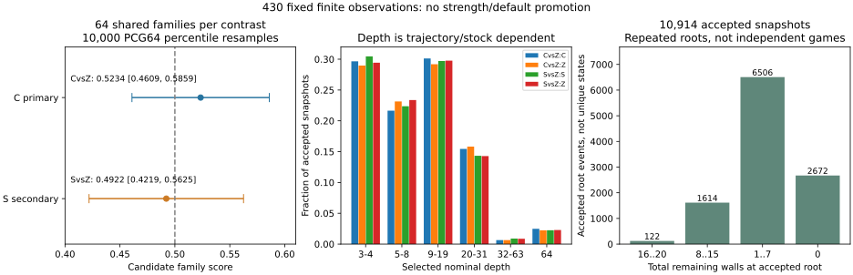
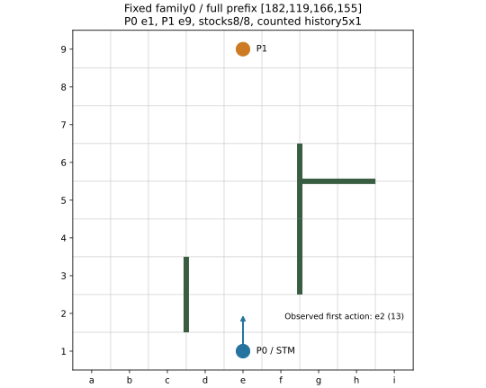

430の固定比較は、主要CvsZが67勝61敗、score 52.34375%、64-family bootstrap 95%区間[46.09375%,58.59375%]で、事前条件「下限>50%」は未達だった。副次SvsZは63勝65敗、49.21875%、[42.1875%,56.25%]。Cは固定Claustrophobia1.3.1、Sは固定Sigmaのstatic値で学習し、Zは勝敗zで学習した条件。C/Sへの変更を一般的な棋力改善・モデル昇格・既定変更の根拠にはしない。この結果は教師の無効・同等性・劣位も証明しない。

元8操作・256 unique/entered/returned局は全GOAL、UNKNOWN0、各対照64 complete colour pairsだった。同じ64開始familyを二対照で共有するため、128独立開始とは扱わない。原nativeの各16-family区間は残し、平均せず、旧423/426結果も合算していない。

| 固定対照 | W/D/L | family score・95%区間 | 候補二勝/一勝/零勝family | 候補P0勝・P1勝（各64局） | 判定 |
| --- | --- | --- | --- | --- | --- |
| CvsZ・主要 | 67/0/61 | .5234375 [.4609375,.5859375] | 11/45/8 | 31/36 | NOT_MET |
| SvsZ・副次 | 63/0/65 | .4921875 [.421875,.5625] | 10/43/11 | 33/30 | 記述的 |

全64系列の二色結果・prefix/実在庫・lineageは[family表](families.csv)、256局のslot/batch/local game/RAW行SHAは[game表](games.csv)に保存した。valid-game平均・complete-family平均・planned boundsは今回は同値であり、欠測が生じた場合の分母を同一視する一般規則ではない。prefix長4/8/12/16は各16系列だが、pawn移動を含むprefixもあるため実残壁数は単純な20−prefix長と常には一致しない。全層の探索的得失は`family-join-result.json`に残し、有利な層を選び直して検定しない。

比較したのは同じBEST43初期化からの三つの新規paired fitであり、Zはliteral z、S/Cは固定static teacherの値のみを使った。同じ選択T3763/common V2498、fresh Adam、LR1e-4/10-step warmup、batch256、117 full batches+tail152、118更新/30104draws、reflection15038、実stream SHA256 `76f6467be9fd107dcfea8212e2aa512c8a26c578cad9b397f2465baaf74ddbcd`でLAST118を比較した。条件ごとのBEST選択は行っていない。

ZのLAST descriptor/weightsは旧W endpointと同一だったが、旧Wのper-update RNG/順序履歴を証明したことにはならない。今回のZをpaired baselineとし、旧W対局の合算や再演はしない。S/Cのadapter・反転board+完全history・split/config対応は既存430.3の独立確認を再用し、分析者の自己reviewで置換していない。

| 同じV2498 | 自分の教師へのMSE step0→LAST118 | LASTのz-MSE | z符号一致 /2498 | 自分の教師family-MSE 改善/悪化（52V） |
| --- | --- | --- | --- | --- |
| Z | .9831882171→.9559888045 | .9559888045 | 1601 | 29/23 |
| S | .5576742319→.5291078738 | .9483830786 | 1598 | 45/7 |
| C | .4970720001→.4714848820 | .9502079893 | 1605 | 43/9 |

三条件とも自分の教師への全体T/V誤差は減った。ただし教師分布と尺度が異なるため、MSE .47/.53/.96の大小でモデル・教師の優劣を比較しない。同じzに対するV-MSEはS、C、Zの順、符号一致はC、Z、Sの順で、対局scoreの順とも一致しない。保存された個々の誤差重なり・S/Cのz層別誤差がない範囲はUNKNOWNのままで、新forwardで表示を埋めていない。

opened-public V419150のLAST z-MSEはZ .4256808014、S .4258367104、C .4269061078。これは同一public指標での記述であり、430にないINITIAL public観測を作った改善/悪化判定ではない。全曲線・符号・saturation・stock・family表は、凍結した[先行fit解析](../fit-teacher-analysis-v1/report-ja.md)とその`curves.csv`/`stock.csv`/`families.csv`を参照する。再測定は0。

入力Tのstock16..20/8..15/1..7/0は314/1183/1632/634、Vは76/558/1709/155で、stock18..20はT/Vとも0だった。S/C自身のstock0 V-MSEは僅かに悪化しており、全体低下を全層改善とは扱わない。INITIAL Vで予測[.8,1]の609行は平均予測.957759に対し平均z .602627、S .606747、C .606649だったが、これは保存binの記述であり、特定局面・手のoracleではない。

static label bankはcanonical6261+reflectedT3763=10024 finite rows/teacher。inclusive S10081/C10062には原S failed19/kernelUNKNOWN等を含む。Cの固定19状態single/batch最大差1.7881393432617188e-7（許容1e-6、bit一致5/19）、Sはserial native batch1で19/19 bit一致だった。これは有限対応であり全入力parityではない。teacherはpolicyを探索orderingへ使わず、joint policy/value計算をしたSの費用も純value kernel費とは呼ばない。

新LASTのnative correspondenceはZ/S/C各120 logical heads、24 visited-state counter、18 child rowsと親復元、計360。fit 1521198と合わせた学習・native対応のNNUE rowsは1521558<12M。これは対局のSearch評価仕事を含む全NNUE head数ではない。真正Build9bf66048/test82483/fixturea846とarena image35e47e65を使い、モデル・library本体の追加読取や再資格試行は行わなかった。

arenaはControl/PVS/TT1048576/LMR ON-depth_rank、approx/safe leaf OFF、100ms authority receipt/5ms reserve、1M nodes/手、depth64、序盤込み200ply。各32-slot操作250M nodesは独立で、合計charged1072837747≤2G。未使用枠の貸借・再戦・補充は0。CvsZ 550989260、SvsZ 521848487 nodesであり、異なる軌跡と値・仕事を同一workの速度比較にしない。

| 対照・モデル | accepted completed snapshots | nominal深さ median / mean / ≤4 / ≥20 / =64 | whole nodes | static evaluations | LMR試行 / full-depth確認 / full-window再探索 |
| --- | --- | --- | --- | --- | --- |
| CvsZ C | 2785 | 8 /11.8711 /826 /517 /69 | 274073566 | 137285716 | 10158576 /52762 /730 |
| CvsZ Z | 2782 | 8 /11.7779 /806 /520 /62 | 276915694 | 140118292 | 10341500 /47586 /729 |
| SvsZ S | 2673 | 8 /11.5784 /814 /467 /60 | 260227245 | 132491233 | 10155622 /63449 /671 |
| SvsZ Z | 2674 | 8 /11.6387 /787 /466 /61 | 261621242 | 133433464 | 10291848 /59033 /744 |

深さはselective nominalであり全幅深さ・勝因ではない。accepted rootの残壁16..20/8..15/1..7/0の分母は122/1614/6506/2672で、残壁0はmedian21、残壁16以上は3〜4だった。大きな深さの尾部は局面構成にも依存する。色別・全深さ分布は[depth表](depth-distributions.csv)に保存した。

selected snapshot nodes761635360とwhole nodes1072837747は重なる見方であり加えない。TT probes/key_hits/usable-depth/cutoffも包含・別判定を含むため足して「総hit」としない。TT retained83886128B/1M slotsは容量gaugeでRSSではない。arena report.nn_calls=0はinference-pump用fieldであり、NNUE head/forward0の測定結果ではない。physical FT/head hardware、continuous RSS、孤立したTT/LMR/head費はUNKNOWN。

10914 acceptedは全てcompleted-iteration snapshotで、fallback0、error0、authority legal false/unknown0、late receipt0、validation failure0、matching terminal全回収、drain後inflight0だった。stopはinternal_time_limit10651、depth_cap252、cancelled11。reserve stopのcancelledをUSERPAUSEやuser取消と同一視しない。return-after-deadline1939、commit-after-deadline2183は別scopeであり、期限内に受領したauthority actionのlate receiptとは異なる。hard realtime return保証ではない。

caller平均はCvsZ C/Z 97.412/97.539ms、SvsZ S/Z 97.873/97.963ms。caller・選択snapshot thinking・Search内部・setup/session・journal/dropはnestedなので加えない。全turnのpooled clock中央値は小抽出に保存せずUNKNOWNとし、batch中央値の中央値へ置換しなかった。native whole wallや強さを個別時計から再構成していない。

具体例は結果で選び直さず、最初のfamily0・最初の着手（slot0/1/128/129、各archive行1/2）を固定した。完全prefix `[182,119,166,155]`、P0=e1/P1=e9、STM=P0、在庫8/8、五つの履歴key各count1が同じrootである。

| 元対照/slot・実評価器 | 実選択 | Search値 STM / 完成深さ | 保存PV | selected/whole nodes | authority receipt / return ms |
| --- | --- | --- | --- | --- | --- |
| CvsZ/0 C | e2(13) | .5372215 /3 | 13,87,205 | 18330/46675 | 51.659/99.229 |
| CvsZ/1 Z | e2(13) | .22150038 /4 | 13,67,165 | 49915/63530 | 81.144/98.392 |
| SvsZ/128 S | e2(13) | .18534984 /4 | 13,67,165,128 | 50702/59517 | 85.951/99.700 |
| SvsZ/129 Z | e2(13) | .22150038 /4 | 13,67,165 | 49915/55968 | 89.230/98.443 |

この例は全て同じ手を選び、C/Sの選択差を示していない。値は異なる完成深さのsearched値でstatic teacher値ではない。同じZでもterminal work/時計が異なり、内部状態・時計を揃えた反実仮想比較ではない。slot0は52plyでP1勝ち、slot128は53plyでP0勝ちだったが、最初のe2を悪手/正解に認定しない。RAW参照・行SHA・完全root/history・PV・実続行先頭8手は`examples.json`にあり、全木や新Searchは作っていない。

8 gzipは各一度だけdecodeし、CRC/EOF、RAW全行SHA/bytes、各game行SHA、32×8 census、compressed SHA-size-mode前後を照合した。plan/schedule/全prefix・7つのFamily項目/lineage・重み付き履歴/root board・STM/行動/goal-first・loaded typed models/clock/quotaは保存証拠とjoinした。native入場の合法性を再利用し、新しいBFS/solverや内部TT-historyの全面検証はしていない。native local表示名で系列を合算していない。

最初のhelperはunused `plan`でRuffを拒否され、RAW入場前に固定plan256/64の使用へ修正した。最初のarchiveのshadow wall-keyは壁座標のrow順を使い、正本のx,y順と異なった。整数boardは一致しており、保存prefix/metadataから文字列表現だけを訂正し、archiveを再decodeしていない。元差分記録は残した。summary helperのunused import拒否も原captureを保持した。元の数値データは修復していない。

費用は元arena job95542478 outer1105.9421423960011秒を一度だけ数え、8 native/operation spansを加えない。元schema-pre-runtime e1692646 FAILED6.7439486180082895秒、c887 native submit NOT_STARTED wrapper2.017269903997658秒、全旧FAILED/NULL-vs-disk/S19/kernelUNKNOWNも保持した。保存bank outer207.746057799、fit Z/S/C outer4.504441356/3.355982496/3.567332241、native対応outer1.678843844を含む選択済み既知outer小計は1335.5560186540547秒であり、全費用ではない。head-call wall S37.970209929/C105.701553413はbank outer内部で加えない。source/LLM/admin全費・連続peak等はUNKNOWN。

CPU5/guardian9は別physical、family1GiB（controller込み）/GPU0/hostreserve4GiBで、既存guardのaffinity/NoNewPrivs/RSS/直接wait-reapを使った。RAW/統計/plotと共有Main source-readerは自然な実STOPで解放し、残る私有報告は旧shared caller版を要求しない。最終のguard/known PID-start-boot・fresh identity・handles/TMP/leases/owned記録は`STOP.json`、一度の新holding/同じwhole128MiB占有点は`storage-usage.json`に保存する。元archive/model/checkpointのコピー・再課金・refund、global全域scanは0で、decimal50GB/globalactualUNKNOWNを維持する。将来の静穏・hardware leaseは保証しない。

原430の有限比較は完了した。static教師への追従・z指標の変化と、固定bookの対局結果を結び付けて保存したが、S/C優越や旧敗戦原因を支持する強い結論は得られなかった。再fit/teacher再選定/新対局や次の学習設計は発行せず、S/Cを自動昇格しない。元モデル/label/RAW/FAILEDと費、不明を保持し、Main/publication・重要結論の限定独立確認は324へ渡す。430.2は元owner/in_progressをacceptanceまで維持する。
