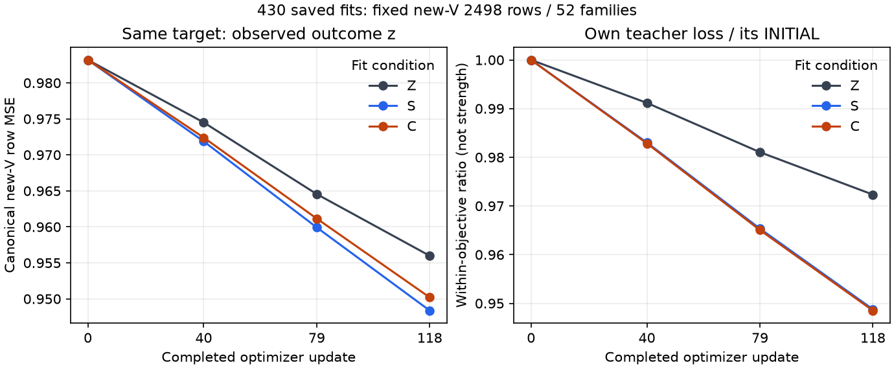

430の実三fitは、**それぞれの教師へのT/V誤差を減らした**。同じnew-V2498行のz-MSEも三条件すべて低下したが、MSE・符号・公開Vで順序が異なる。これは固定入力・固定LAST118の保存観測であり、棋力、教師の真値、一般優越、原因の確定ではない。原256対局とnative重み対応はこのpacket時点で未収集の実依存である。

この解析は原430.2/Sol6.1 maxの続きである。430.3のactual-label/control ceaa824e、report6e56daa1（blockers0/ordinary0）を再用し、source/adapter/labelの独立確認を重複しなかった。model・checkpoint・NPZ・旧RAW・teacher float bodyを読まず、実completion/config/training.jsonの保存集計だけを用いた。追加forward/fit/Search/solver/game/bootstrapは0。以下の未保存/UNKNOWNは今回選んだ実集計表の範囲を指し、checkpoint本文や全journalを調べた不在証明ではない。実統計入力は[結果JSON](result.json)、[全曲線CSV](curves.csv)、[層別CSV](stock.csv)、[family別CSV](families.csv)へ参照を結んだ。

**入力・endpoint・実stream。** originalT3763 distinct/204families、canonicalV2498 distinct/52families、reflectedT3763。S/Cは反転後の盤面と完全履歴を実際に評価しており、scalarの左右対称性を仮定しない。原cache z/splitとrow IDは不変。三条件の正規化config差はmixture.teacher_values.objectiveだけ、BEST43/fresh Adam、全LR列、stream attempted/completed digest76f6467b、実NumPy2.5.3/Torch2.14.0+cu130が一致した。各118updates/30104draws/末尾152、反転15038行。8回分のdrawsと3763実distinctを分ける。対局用は三条件ともLAST118固定で、今回はdescriptive BESTも118だったという事実で選び直さない。

新ZのLAST descriptor/weightsは保存Wのfbf0beb8/ab073fb1と一致した。これは保存endpointの一致であり、旧Wの歴史的な実順序/RNG binding gapを埋めた認定ではない。旧423/426成績・CIを新arenaへ合算せず、旧fitを再演していない。

| 条件/教師 | Tのown-MSE INITIAL → LAST | Vのown-MSE INITIAL → LAST | Vのown-family-MSE INITIAL → LAST | own V改善family |
|---|---:|---:|---:|---:|

| Z | 0.871007 → 0.824278 | 0.983188 → 0.955989 | 0.945876 → 0.915511 | 29/52（悪化23） |

| S | 0.445572 → 0.412477 | 0.557674 → 0.529108 | 0.549971 → 0.518767 | 45/52（悪化7） |

| C | 0.367589 → 0.331033 | 0.497072 → 0.471485 | 0.482898 → 0.455064 | 43/52（悪化9） |

各行はその同じ教師への変化である。INITIALのNNUE出力が同じでも、CへのV誤差は最初から0.497072、Sは0.557674、zは0.983188であり、教師ごとのown-MSEの小ささを学習成果や強さの順位に変換できない。canonical無反転T/Vの観測で、訓練時のmask付きreflected-target損失とは対象が異なる。途中updateごとのtraining-objective loss、gradientやoptimizerの機序は未保存/未調査であり、ここから復元しない。

実4観測0/40/79/118では三条件ともown T/V MSEとV family-MSEが末尾まで低下した。118が最適、追加更新が効く、過学習しないという保証にはならない。familyごとの悪化も残り、2498行や反転viewを独立標本数として扱わない。

[SVG](fit-curves.svg)。左は同じzに対するMSE。右は各自の教師に対するINITIAL比で、教師間の強さを表さない。線は4保存点を結んだ表示で、追加測定・信頼区間ではない。

**同じtargetでのLAST比較。** 共通T/Vでは実trainerがreference_targetsを保存していたため、その実cross-MSEを再用した。新forwardで空欄を埋めていない。

| LAST model | V z-MSE | V S-MSE | V C-MSE | z符号一致/2498 | 飽和率（|v|≥.9） |
|---|---:|---:|---:|---:|---:|

| Z | 0.955989 | 0.537861 | 0.481132 | 1601/2498 | 36.549% |

| S | 0.948383 | 0.529108 | 0.472758 | 1598/2498 | 36.349% |

| C | 0.950208 | 0.528246 | 0.471485 | 1605/2498 | 36.990% |

共通INITIALのz符号一致は1589/2498、飽和率39.351%だった。SはV z-MSEでZより0.007606低いが、z符号一致はZより3行少ない。Cはz-MSEでZより0.005781低く、z符号一致は4行多い。MSEは符号と大きさを共に含むため、両指標の順序は一致しない。誤りが重なる行のjoint情報やper-row予測は未保存であり、有意差/paired-error testや改善した具体着手を推定しない。

同じS targetへのV-MSEはCmodel0.528246、Smodel0.529108で、own teacherを学習したmodelが全target/全scopeで最小になるわけでもない。一方、T z-MSEはZ0.824278、S0.831289、C0.830394でZが小さい。これらは同じ有限表上の差であり、C/Sの全般的な優位や教師の正しさではない。

公開VはLASTの419150行だけ実測され、Z 0.425681、S 0.425837、C 0.426906。S/CはZよりそれぞれ0.000156/0.001225高い。今回の公開V INITIALと公開S/C教師値は未保存であり、追加forwardや旧runからの仮想補充をせずUNKNOWNにした。公開T診断8192行と公開Vも別分母である。

**在庫層。** 実Vの層別own-MSEを示す。各列のtargetは異なり、列間の数値の大小を教師の強さにしない。S/Cmodelのz層別MSE、非objectiveのfamily-MSEは保存されていない。

| 合計残壁 | V行 | Zのz-MSE 0→118 | SのS-MSE 0→118 | CのC-MSE 0→118 |
|---|---:|---:|---:|---:|

| 16..20 | 76 | 1.227784 → 1.159371 | 0.200641 → 0.170408 | 0.188201 → 0.145796 |

| 8..15 | 558 | 1.105741 → 1.078505 | 0.543171 → 0.489222 | 0.434788 → 0.379708 |

| 1..7 | 1709 | 1.002635 → 0.974814 | 0.620974 → 0.598160 | 0.574054 → 0.556506 |

| 0..0 | 155 | 0.207648 → 0.207640 | 0.087017 → 0.087216 | 0.023954 → 0.024145 |

S/Cの壁0の155行ではown-MSEがわずかに増加し、各教師との符号一致率は変わらなかった。全体改善だけで全層改善とは言わない。T層分母は16..20:314、8..15:1183、1..7:1632、0:634。Vの16..20は76行しかなく、実stock18..20はT/Vとも0なので、その範囲の検証とはならない。空層の補充・teacher/state/endpointの再選定はしない。

**読める一例は集計binであり、一局面ではない。** 事前のnumeric最高bin[.8,1]を共通INITIALのVから読むと、609行の平均NNUE値0.957759に対し、保存z平均0.602627、S単体値平均0.606747、C単体値平均0.606649だった。数値と参照targetの隔たりは観測できるが、単体valueを勝率へ読み替えず、各行の正解や、どの候補手が変わったかはこの集計から分からない。局面・着手の具体例は実native/arenaの保存証拠が到着した後の原430分析へ残す。

**教師の対応と費用。** frozen bankはS/C各10024有限行。inclusive attemptsはS10081/C10062、合計20143で、新bank finite20048と別分母。元failed S19はfinite0、実kernel execution UNKNOWNのまま課金履歴に残る。固定19境界ではC single/batchのmax差1.7881393432617188e-7（tol1e-6、bit一致5/19）、S serial-native1はmax0/bit一致19/19という430.3受入れ事実を再用した。これは19状態の対応であり、全入力bit parity・global truth・scalar LR invarianceを認定しない。

新label制作は各314 Python groupsで、Sは固定native batch1へserial dispatch10024回、Cはnative314 calls/10024 input rows。両者ともjoint policy+value計算を行うが、policyを探索順序やMCTSに使っていない。このbank jobのconstructor-forward/explicit warmupは各0、失敗/境界を含む全履歴のkernel tracingはUNKNOWNである。

| 実scope | outer秒（各一度） | 内包された参考span（加算しない） |
|---|---:|---|

| 新label bank | 207.746058 | S同期head-call wall 37.970210s / C 105.701553s |

| fit Z | 4.504441 | trainer wall 1.801072s |

| fit S | 3.355982 | trainer wall 1.324802s |

| fit C | 3.567332 | trainer wall 1.388580s |

| 上記4outerの既知小計 | **219.173814** | 事前boundary/source/失敗/LLM/admin全費を含む全額ではない |

head-call wallはframework/native dispatch・同期を含むspanで、exclusive profiled kernel timeではない。outerへ再加算しない。モデル・batchの異なる一回の制作時間を一般的な推論速度や棋力の比較へ使わない。三fit各507066有限NNUE rows（train30104＋measurement476962）＝合計1521198。共有INITIALの架空creditはなく、三条件が実際に測定した分を数えた。native対応の3072 reserveはこのpacket時点のactual workではなく、Rootの実結果が来てから加える。対局の2G node capは別仕事である。

元source70bd R1、oracle R2/case16、preentry guardian v1/v2、S19失敗、metadata result.json/exposure added_visits想定の失敗を残し、収集修復をfit/forward再実行やretroactive PASSへ変換していない。empty TorchTMPの後処理scopeも原receiptのまま。全費・continuous RSS・物理kernel計時は未測定ならUNKNOWNである。

**解釈。** 支持されるのは、この共通入力・同じprospective stream・固定118における有限の教師模倣とz集計差である。教師の数値のsoftness/discount、初期NNUEとの近さ、学習の配分・表現能力、固定自己対局分布と実arena目的の差は競合説明であり、勾配等から単独原因を確定していない。特にCのdiscount校正はUNKNOWNで、raw zeroは確定Drawではない。新Vの小さい差、公衆Vの逆方向、壁0の局所悪化、少数の高stock行を併記する。

次は元から固定されたCvsZ主/SvsZ副・同64starts/計256局の実保存結果とnative対応を待つ。親close・Root/human ACKはgateではなく、source/入力/資源など本当の依存だけを使う。この分析から追加fit、再教師付け、cap/teacher/roots/epochの変更、default/模型昇格は発行しない。原科学の新forward/Search/game/solver/bootstrapはこの担当から0。本人430.2はsaved最終分析とowner受入れまでin_progressを維持し、すべての旧USERPAUSE/default/models/seals/RAWFAILED/feesUNKNOWNを保持する。

