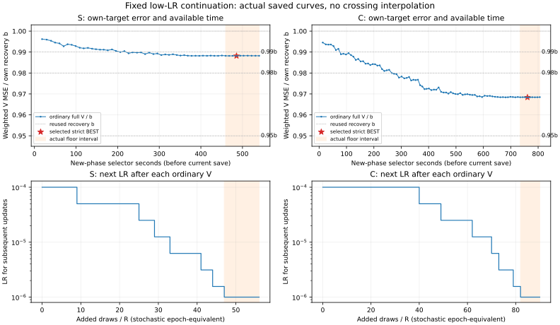

# S/C静的教師NNUEの低LR継続学習

2026-10-18 JST。元job `29791b0e-be11-462f-8249-e4ba044d3729` の保存結果。

両モデルは固定された実用的な全V plateau条件で自然停止した。自身の復帰BESTから選択BESTへの全weighted-V MSE改善は、Sigma静的教師NNUEが **1.1830%**、Claustrophobia静的教師NNUEが **3.1636%**。二fit・通常V・保存・制御を包む元outerは **1,348.591948秒（約22分29秒）**だった。低LR継続で旧選択点を改善できた有限観測であり、低LR単独の因果・最適LR・一般的な十分学習・棋力・教師優劣を示す結果ではない。旧32RのNOT_CONVERGED/NEEDED_WORKは変更しない。

## 固定条件と復帰点

同じS/C教師bank、T/V、元観測multiplicity、T-only尺度、architecture、FP32、batch4096、左右反転0.5を維持した。新教師・再ラベル・データ追加・対局・製品モデル変更はない。

両方とも旧BEST step21,265／87,101,440drawsの重みと対応するAdam・index RNG・reflection RNGから復帰した。旧LASTの状態を混ぜず、fresh Adam・warmup・旧baselineの再forwardを行っていない。旧実行全体21,950更新／89,907,040drawsと、選んだ分岐点・新phaseの仕事を分け、旧tailを返金しない。

開始LRは1e-4、半減倍率0.5、有意改善なし3観測で減衰、floor1e-6。有意改善は `max(1e-5, 1e-4 × significant_best_V)` を超える低下とし、strict最小BESTの更新とは分けた。追加1R相当ごとに通常の全Vを一度評価し、ceil更新境界を記録した。16Rの保存境界で状態・会計をresetせず、最大追加256R・各850M新logical NNUE行／計1.7Bの有限枠を設定した。

実用的plateauには、floorで実際に8R以上学習し、8回連続で有意改善がないことの両方を要求した。floorでの持続的Tpanel改善／V悪化によるoverfit、非有限、資源停止は別判定である。原条件は[結果前protocol](protocol.json)、実source・設定・対応状態・保存結果と確認は[受入れと原参照](receipt.json)へ束縛する。

R＝2,809,595は元T観測multiplicityの分母。旧各32R＝89,907,040drawsは、各観測6～64回の復元抽出と左右反転を含む。均等な32完全走査ではなく、追加分も同じR相当と実draw数で示す。

## 実結果と選択BEST

| 教師                |         復帰BEST V |       新選択BEST V | BESTの追加更新／R | STOPの追加更新／draws／R       |             LAST V |
| ------------------- | -----------------: | -----------------: | ----------------- | ------------------------------ | -----------------: |
| Sigma（S）          |  .2164902889481301 |  .2139291421256651 | 34,297／50.000271 | 38,413／157,339,648／56.000829 | .21393953123504053 |
| Claustrophobia（C） | .14290233048332288 | .13838154099741007 | 58,305／85.000607 | 61,735／252,866,560／90.001071 | .13839672137588366 |

両方PRACTICAL_V_PLATEAU、最終LR1e-6、overfit streak0。実停止は資源上限・非有限・overfitではない。Tpanelも復帰→選択BESTでS .2028382516257609→.19900366847431425、C .1353333171688042→.12968664660889834へ改善した。固定診断panelの結果を全Tや一般母集団の過学習証明にはしない。

新BESTの対応Adam stepはS55,562／C79,570、新LASTは59,678／83,000。重み・状態の対応は元producerの保存custodyに基づき、解析者はモデルやcheckpoint payloadを読み直していない。

## 自身の同精度帯へ初めて入った通常観測点

各bはそのteacher自身の復帰BEST全V。0.99b／0.98b／0.95bは初回進捗後に追加された記述軸であり、学習STOP・BEST選択・追加Vの条件ではない。

| 教師・帯        | 初回追加更新 | 実draws／R            | selector秒 | 使用LR |
| --------------- | -----------: | --------------------- | ---------: | -----: |
| S：0.99b        |       13,719 | 56,193,024／20.000400 | 206.571717 |   5e-5 |
| S：0.98b／0.95b |         未達 | —                     |          — |      — |
| C：0.99b        |        5,488 | 22,478,848／8.000743  |  79.788491 |   1e-4 |
| C：0.98b        |       19,893 | 81,481,728／29.001236 | 265.416046 |   1e-4 |
| C：0.95b        |         未達 | —                     |          — |      — |

最初の記録だけを用い、観測間の正確な交差時刻を補間しない。selector時計は新phaseの初期化・通常Vを含むが、当該点自身のcheckpoint／curve保存前である。その保存完了時刻はUNKNOWN。再用baselineに残る時計は旧観測のもので、新phaseの時刻ではない。両teacherのMSEや速度を比べて教師の優劣を付けない。[全帯と分母](time-to-error-bands.csv)。

## LR段階と確認尾部の費用

Sの最初の減衰は約9R、Cは約40Rだった。Cの1%／2%帯は1e-4段階、Sの1%帯は5e-5段階で記録された。位置・Adam状態・乱数消費も進んでいるので、減衰単独の効果とは解釈しない。使用LRと全V後の次LRを区別し、[各段階の利得と費用](LR-stages.csv)・[減衰直後の通常観測](decay-next-observation.csv)を残す。

| 教師 | 最後の有意改善→STOP selector秒 | strict BEST→STOP 更新／R／selector秒 | floorの実draws／stale／selector秒 | floorのrunning BEST改善 |
| ---- | -----------------------------: | ------------------------------------ | --------------------------------- | ----------------------: |
| S    |                     162.182167 | 4,116／6.000557／54.395975           | 25,284,608／9／80.568146          |            約5.44745e-6 |
| C    |                     125.107308 | 3,430／5.000464／45.172786           | 22,478,848／8／71.519657          |            約5.05118e-6 |

Sの8stale時点のfloor draws22,474,752は、必要8R＝22,476,760に2,008draws足りなかった。次の通常VでAND条件を満たしたため、9回と8回の違いだけで無駄や不具合とはしない。最低LRへ到着しただけでも停止していない。

floor・最後の有意改善後・strict BEST後の区間は重なるため加算しない。尾部には小さい利得に対する確認費がある。ただし、この事後内訳からBEST時点を事前に知って安全に止められたとは言えない。旧3e-4も旧有限horizon末まで改善しており、高いLRの可能性自体は排除できない。一本ずつの軌跡から、初速・減衰時機・floor確認のどれを変えれば最短になるかは識別できない。

研究判断は、条件付きの「2e-4一定・各4R・二枝」案を今回は採択・発行しないと決定した。control自身の1%到達が20R／8Rなので、4Rで未達なら同精度やplateau速度の判断は残る。初期1%到達が意思決定を変える場合には小比較の情報価値はあり得るが、短い初速確認を全収束速度の証明へ広げない。新fit・sweep・quota・支持を発行していない。

## 仕事量・時計・保存境界

新NNUE行はS184,150,544＋C295,955,500＝480,106,044。training410,206,208と通常selector69,899,836（146×478,766）で、旧baselineの新headは0。旧211,412,636行は別に保持し、累積691,518,680行。teacher labels7,088,266は別単位である。各850M／whole1.7Bをreset・移転せず、未使用枠を他工程へ貸与しない。

通常Vは312,247 weighted観測／354,331実orientation、Tpanelは65,536 weighted観測／124,435実orientation。familyや独立game数ではない。[通常全観測点](all-recorded-points.csv)を保存した。

fit完了時計はS540.205904秒、C806.381649秒。これらとguardian・phase時計は元outer1,348.591948秒の内側であり、outerへ足さない。元nativeSTOPは2026-10-17 23:50:31.997243 UTC、outer完了は23:50:32.249946。原collector reader STOPは23:53:18.199598、解析の最終reader STOPは2026-10-18 00:05:06.398453 UTC。notificationや後続管理の寿命は別で、host全体の将来quietを認定しない。

新工程whole96MiBは一度発行した支持で、元postwork点35,844,096Bを保持する。解析の新対象だけの実測と後続管理tailは別に残す。global actual・連続peak・physical NNUE／kernel回数・全費用はUNKNOWN。旧used／FAILEDの返金、旧wholeの再適用、全域inventoryは行っていない。初回gzip形式入口の解析helper失敗、原FAILED、NULL／disk差と元費用も保存する。

## 後続と限界

今回の新S BEST34297（weights `845e2bd0…`）と新C BEST58305（`35cbb976…`）を324.6のsubjectへ実FileRefで凍結した。LAST・旧BEST・将来のLR候補へ置換しない。新source／image／native対応、形式、保存支持、公平な実STOPは後続性能比較の実依存であり、本結果から資格を推定しない。

同じ実装担当が、原学習・回収・対象読者STOP後の設定一元化を行う。元runのimmutable source／設定／モデルを変更せず、整理後sourceをこの実測済みsourceへ付け替えない。製品・generator・defaultモデルの昇格は行わない。全USERPAUSE323／342.17、seals／newE／oldfits96、原RAW／FAILED／費UNKNOWNを維持する。

出典・実source／環境／receipt／図表と独立確認・受入れの正確なFileRefは[receipt.json](receipt.json)に記録する。固定条件と必要な限界だけを採り、一般的な収束保証・最適LR・棋力認定へ広げない。

最終保存結果と時間精度の限定解釈は、同じ独立Highのcontrol38858aaa／report5c55d8c0でclear・blockers0・ordinary0と確認された。元protocol／source／R1や科学実行の再演をせず、解析の146通常記録とproducerの保存projection等を照合した範囲の確認である。
